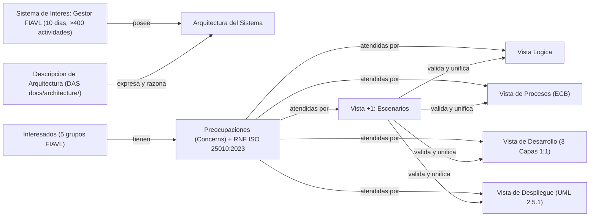

# Descripción Arquitectónica — Visión General ISO/IEC/IEEE 42010 y Calidad ISO/IEC 25010:2023 (FIAVL)

- **Sistema de Interés:** Gestor de Programación e Itinerarios Urbanos del Festival Internacional de Artes Vivas de Loja (FIAVL)
- **Secciones del DAS cubiertas:** Sección 1 (Resumen y Restricciones en enlace a `specs/000-tdr/tdr-y-requisitos.md`) y Sección 2 (Interesados, Preocupaciones, Atributos de Calidad Verificables, Riesgos Técnicos y Puntos de Vista 4+1)
- **Versión del documento:** `0.1.0` (Prompt 1 — Rama `spec/carlos/000-tdr`)
- **Estándares rectores:** `ISO/IEC/IEEE 42010`, `ISO/IEC 25010:2023`, `Modelo 4+1 de Kruchten`, `OMG UML 2.5.1` (expresado en Mermaid compatible con DeepWiki), `AGENTS.md` (R1–R6).

---

## 1. Propósito y Metamodelo ISO/IEC/IEEE 42010

En estricto cumplimiento de **ISO/IEC/IEEE 42010**, este artefacto distingue la **Arquitectura del sistema** (propiedades estructurales y de comportamiento inherentes al sistema en su entorno) de la **Descripción de Arquitectura (DAS)** (artefacto documental versionado en `docs/architecture/`).

### Principio de Validez Arquitectónica
Toda vista y diagrama que se construya en los pasos siguientes existirá **única y exclusivamente porque responde a preocupaciones reales de interesados concretos**. Ninguna vista incluirá elementos sin trazabilidad hacia interesados, atributos de calidad o requisitos de `specs/000-tdr/tdr-y-requisitos.md`.

---

## 2. Tabla Completa de Interesados (*Stakeholders*) y Preocupaciones (*Concerns*)

| ID | Interesado (`Stakeholder`) | Rol en el Ecosistema FIAVL | Preocupaciones Arquitectónicas (`Concerns`) | Vistas 4+1 que Responden |
| :--- | :--- | :--- | :--- | :--- |
| **INT-01** | **Asistentes (Público general y turistas)** | Consultan cartelera en web/móvil en calle, arman itinerario urbano, reservan cupos en teatros de 5 USD y reciben alertas. | • Encontrar rápido actividades entre >400 opciones sin frustración en pantalla móvil. • Evitar traslapes horarios en su itinerario. • Garantizar que un cupo reservado no se pierda ni sufra doble venta. • Consultar su itinerario en calle incluso con señal débil o sin conexión. • Recibir avisos oportunos ante cambios de sala, horario o aforo lleno. • Protección y consentimiento explícito sobre sus datos personales (LOPDP 2021). | Escenarios (+1), Lógica, Procesos, Despliegue |
| **INT-02** | **Organizadores FIAVL** | Dirección artística, programación y coordinación operativa del festival durante los 10 días. | • Actualizar rápidamente horarios, salas o cancelaciones de >400 actividades sin conflictos de programación. • Publicar alertas operativas masivas de inmediato sin que el sistema se congele. • Consultar ocupación exacta de funciones pagadas y validar códigos de reserva en ingreso sin hardware complejo. • Contar con trazabilidad de quién modificó cada función o aforo. | Escenarios (+1), Lógica, Procesos, Desarrollo |
| **INT-03** | **Elencos y Administradores de Sedes** | Teatros cerrados (boleto 5 USD, aforo limitado) y responsables de plazas/calles/parques públicos. | • Respetar de forma estricta la capacidad física máxima de cada teatro (cero sobreocupación / seguridad de recintos). • Evitar que se programen dos funciones al mismo tiempo en la misma sede. • Liberar cupos reservados no confirmados a tiempo para evitar butacas vacías y aglomeraciones en puertas. • Comunicar cambios de sala o cancelaciones técnicas con la menor fricción posible. | Escenarios (+1), Lógica, Procesos |
| **INT-04** | **Operaciones / TI y Seguridad** | Administración de servidores/nube, redes, soporte durante los 10 días y cumplimiento normativo. | • Soportar picos de tráfico en inauguración y funciones estelares sin caída del servicio. • Aislar servidores de aplicación y bases de datos en red interna fuera del alcance directo de Internet. • Evitar que la caída de un proveedor externo de correo/push tumbe la cartelera o las reservas. • Operar dentro de costos acotados de infraestructura académica/institucional y mantener respaldos y monitoreo. | Procesos, Despliegue |
| **INT-05** | **Equipo de Desarrollo (3 Integrantes)** | Estudiantes/arquitectos responsables de especificar, modelar, implementar y probar el sistema. | • Trabajar en paralelo por módulos sin conflictos continuos en Git. • Separar reglas del FIAVL de frameworks, bases de datos y pasarelas externas para evolucionar o sustituir tecnología sin reescribir el núcleo. • Mantener trazabilidad directa `specs/ <-> 4+1 <-> src/ <-> tests/` y evitar carpetas desordenadas o ciclos entre capas. | Desarrollo, Lógica, Procesos, Despliegue |

---

## 3. Atributos de Calidad Priorizados bajo ISO/IEC 25010:2023

### 3.1 Cobertura de los 9 Pilares de ISO/IEC 25010:2023

| Pilar ISO/IEC 25010:2023 | Rol en el Proyecto FIAVL | Impulsor Prioritario (`RNF`) |
| :--- | :--- | :--- |
| **1. Adecuación Funcional (*Functional Suitability*)** | Garantiza completitud y corrección de filtros (>400 eventos), itinerario, reservas y alertas respecto a `specs/000-tdr/`. | Transversal (cubierto por `RF-01..RF-18` y criterios de aceptación) |
| **2. Compatibilidad (*Compatibility*)** | Interoperabilidad limpia mediante puertos/adaptadores con servicios externos de mensajería/Web Push sin acoplamiento. | Apoyado por `RNF-02` y `RNF-05` |
| **3. Seguridad (*Security*)** | Autenticación de organizadores/asistentes, TLS en tránsito, consentimiento y minimización LOPDP 2021, auditoría inmutable. | **`RNF-03` (Prioritario)** |
| **4. Eficiencia de Desempeño (*Performance Efficiency*)** | Tiempos de respuesta bajos al filtrar >400 actividades en picos de demanda y lectura rápida en caché PWA en calle. | **`RNF-01` (Prioritario)** |
| **5. Capacidad de Interacción (*Interaction Capability*)** | Flujo ágil en dispositivos móviles desde 360 px en vía pública, prevención de errores de traslape y accesibilidad básica. | **`RNF-04` (Prioritario)** |
| **6. Fiabilidad (*Reliability*)** | Alta disponibilidad durante los 10 días del FIAVL, cero dobles reservas por concurrencia y tolerancia a fallos de mensajería externa. | **`RNF-02` (Prioritario)** |
| **7. Mantenibilidad (*Maintainability*)** | Arquitectura DAG en 3 capas (`Domain -> Utility -> Platform`), 0 ciclos, 1:1 con Git y pruebas unitarias/arquitectónicas para 3 devs. | **`RNF-05` (Prioritario)** |
| **8. Flexibilidad (*Flexibility*)** | Reemplazabilidad de adaptadores (BD/mensajería) sin tocar dominio y capacidad de escalado horizontal *stateless*. | **`RNF-05` (Prioritario)** |
| **9. Seguridad Física (*Safety*)** | Bloqueo estricto de sobreventa por encima del aforo físico máximo en teatros cerrados y advertencias claras de contingencia. | **`RNF-04` (Prioritario)** |

### 3.2 Especificación Verificable de los 5 Atributos de Calidad Prioritarios (`Condición + Medida`)

#### RNF-01 — Eficiencia de Desempeño en Consulta de Cartelera, Reserva e Itinerario en Calle
- **Pilar ISO/IEC 25010:2023:** *Performance Efficiency* (Comportamiento temporal y Capacidad).
- **Dimensión de métrica:** Calidad Externa (pruebas de carga) y Calidad en Uso.
- **Escenario verificable (Condición + Medida):**
  - Bajo una carga pico simulada de **300 usuarios concurrentes** consultando y filtrando una cartelera de **≥ 450 actividades en 10 días**, el **percentil 95 (p95)** del tiempo de respuesta en servidor para búsquedas/filtros y detalle de actividad es **≤ 1.5 segundos**, y el **p95** para confirmar o cancelar una reserva de cupo es **≤ 2.0 segundos**.
  - En un dispositivo móvil con el itinerario previamente sincronizado en caché PWA y sin conexión de red (*offline*), la lectura completa del itinerario personal responde en **< 1.0 segundo**.
- **Implicación arquitectónica:** Índices de consulta adecuados en capa de plataforma, respuestas paginadas/ligeras, caché PWA para lectura en calle sin comprometer la consistencia transaccional de reservas.

#### RNF-02 — Fiabilidad, Exclusión Mutua de Cupos y Tolerancia a Fallos en Notificaciones
- **Pilar ISO/IEC 25010:2023:** *Reliability* (Disponibilidad, Tolerancia a fallos, Madurez/Integridad y Recuperabilidad).
- **Dimensión de métrica:** Calidad Externa (concurrencia, caos y disponibilidad).
- **Escenario verificable (Condición + Medida):**
  - Durante los **10 días continuos** del festival en franja operativa (08:00–23:00), el sistema mantiene una disponibilidad mínima del **99.5 %**.
  - Ante **50 solicitudes simultáneas en el mismo segundo** sobre los últimos cupos disponibles de una función de teatro cerrado, el sistema garantiza **0 (cero) sobreventas o dobles reservas** mediante exclusión mutua transaccional atómica.
  - Si el servicio externo de mensajería (correo/Web Push) falla o excede un *timeout* de **5 segundos**, el **100 %** de las operaciones de reserva y actualización de programación continúa operando sin degradación ni reversión, y los avisos críticos se encolan para reintento con entrega en **≤ 60 segundos** una vez restablecido el proveedor.
- **Implicación arquitectónica:** Región crítica transaccional en reservas (`[critical]`), comunicación asíncrona hacia pasarela de notificaciones (`Utilitario Notificaciones`), aplicación *stateless* replicable.

#### RNF-03 — Seguridad, Control de Acceso y Privacidad por Diseño (LOPDP Ecuador 2021)
- **Pilar ISO/IEC 25010:2023:** *Security* (Confidencialidad, Integridad, Autenticidad, Responsabilidad/*Accountability* y Resistencia).
- **Dimensión de métrica:** Calidad Interna y Calidad Externa.
- **Escenario verificable (Condición + Medida):**
  - El **100 %** de las operaciones administrativas de cartelera, sedes, aforos y publicación de alertas requiere sesión autenticada y verificación explícita de rol (`Organizador`); cualquier intento sin privilegios es bloqueado con rechazo explícito (`0 %` de mutaciones no autorizadas).
  - El **100 %** de las comunicaciones externas entre cliente y servidor opera cifrado sobre **HTTPS (TLS 1.2/1.3)** y los nodos de aplicación y datos permanecen aislados en red interna sin exposición directa a Internet.
  - El **100 %** de las mutaciones críticas (cambios de sala/horario/cancelación, cambios de aforo, emisión de alertas, validaciones de reserva) y consentimientos LOPDP queda registrado en bitácora inmutable con actor, acción y marca de tiempo.
- **Implicación arquitectónica:** Separación perimetral de zonas de red en Despliegue, Utilitarios transversales de `Seguridad` y `Auditoría`, minimización de datos personales en entidades de Dominio.

#### RNF-04 — Capacidad de Interacción Móvil en Calle y Seguridad Física de Aforos (*Safety*)
- **Pilar ISO/IEC 25010:2023:** *Interaction Capability* (Operabilidad, Protección ante errores de usuario, Inclusividad/Accesibilidad) + *Safety* (Restricción operativa y Comportamiento *fail-safe*).
- **Dimensión de métrica:** Calidad en Uso y Calidad Externa.
- **Escenario verificable (Condición + Medida):**
  - En pruebas de uso sobre pantallas móviles desde **360 px de ancho**, al menos el **90 %** de participantes de prueba completa la tarea de filtrar una actividad y añadirla a su itinerario en **≤ 3 pasos lógicos** y **≤ 45 segundos** sin asistencia externa.
  - Ante cualquier intento de reservar una función con `disponibles < solicitados`, una función ya iniciada/cancelada o agregar un evento con traslape horario, el sistema emite advertencia explícita y bloquea el **100 %** de reservas que superen el aforo máximo físico declarado para el teatro cerrado (resguardo físico contra aglomeraciones).
- **Implicación arquitectónica:** Invariantes de aforo y validación de ciclo de vida encapsuladas dentro de las entidades de Dominio (no solo en el cliente), diseño *responsive*/PWA móvil primero.

#### RNF-05 — Mantenibilidad Modular (3 Integrantes) y Flexibilidad de Plataforma
- **Pilar ISO/IEC 25010:2023:** *Maintainability* (Modularidad, Modificabilidad, Testabilidad) + *Flexibility* (Reemplazabilidad y Escalabilidad).
- **Dimensión de métrica:** Calidad Interna (análisis estático/arquitectónico) y Externa.
- **Escenario verificable (Condición + Medida):**
  - El grafo de dependencias entre módulos en `src/` mantiene **0 (cero) ciclos** entre paquetes, **0 (cero) importaciones directas desde `Domain` hacia `Platform`**, **0 (cero) comunicaciones directas `«boundary» <-> «entity»`** y **0 (cero) carpetas genéricas** (`Common`/`General`/`Shared`/`Utils`).
  - Sustituir el proveedor de notificaciones o el adaptador de persistencia afecta únicamente a la capa de `Utility`/`Platform` correspondiente con **0 (cero) líneas modificadas en `Domain`** y un esfuerzo de cambio acotado a **≤ 4 horas** por un desarrollador.
  - Los servicios de aplicación mantienen diseño **100 % *stateless*** permitiendo levantar una réplica adicional en **≤ 2 minutos** ante picos de demanda.
- **Implicación arquitectónica:** Principio gravitacional `Domain -> Utility -> Platform`, inversión de dependencias / aislamiento estricto de plataformas, verificación automática en `tests/`.

---

## 4. Matriz de Trazabilidad Holística Inicial (ISO 42010 ↔ ISO 25010:2023 ↔ 4+1)

| Interesado | Preocupación (`Concern`) | Pilar ISO/IEC 25010:2023 | Meta Verificable (`Condición + Medida`) | `RF` Relacionados | Vistas 4+1 Impactadas |
| :--- | :--- | :--- | :--- | :--- | :--- |
| **INT-01 Asistente** | Consulta rápida (>400 eventos) y lectura en calle con señal inestable | Eficiencia de Desempeño / Capacidad de Interacción | p95 ≤ 1.5 s (300 concurrentes); lectura *offline* itinerario < 1.0 s; ≥ 90 % éxito en ≤ 45 s en móvil ≥ 360 px | `RF-01..RF-05` | Escenarios (+1), Procesos, Despliegue |
| **INT-01 / INT-03 Asistente y Sedes** | Integridad de cupos en funciones de 5 USD y prevención de sobreocupación física | Fiabilidad / Seguridad Física (*Safety*) | 0 sobreventas ante 50 peticiones simultáneas; 100 % bloqueo sobre aforo máximo físico; disponibilidad ≥ 99.5 % | `RF-06`, `RF-08`, `RF-14..RF-16` | Escenarios (+1), Lógica, Procesos |
| **INT-01 / INT-02 Asistente y Organizadores** | Avisos oportunos sin bloquear cartelera ni reservas ante fallos externos | Fiabilidad (Tolerancia a fallos) | 100 % reservas/ediciones intactas aunque caiga mensajería externa; entrega normal en ≤ 60 s | `RF-09`, `RF-12`, `RF-13`, `RF-17`, `RF-18` | Escenarios (+1), Procesos, Desarrollo, Despliegue |
| **INT-02 / INT-04 Organizadores y TI** | Control de acceso administrativo, privacidad LOPDP 2021 y aislamiento de red | Seguridad | 100 % operaciones admin autenticadas; 100 % TLS; 100 % mutaciones y consentimientos auditados; BD aislada en red interna | `RF-09..RF-15` | Lógica, Procesos, Desarrollo, Despliegue |
| **INT-05 Equipo (3 devs)** | Desarrollo paralelo limpio, cambio de tecnología sin romper dominio | Mantenibilidad / Flexibilidad | 0 ciclos; 0 importaciones `Domain -> Platform`; 0 líneas de `Domain` tocadas al cambiar adaptador (≤ 4 h); réplica *stateless* ≤ 2 min | Transversal | Desarrollo, Despliegue |

---

## 5. Tabla Inicial de Riesgos Técnicos y Mitigación

| ID | Riesgo Técnico / Operativo | Probabilidad | Impacto | Pilar ISO 25010 Afectado | Estrategia de Mitigación Arquitectónica | Vista 4+1 Clave |
| :--- | :--- | :---: | :---: | :--- | :--- | :--- |
| **RSK-01** | **Condición de carrera en funciones de teatro con aforo limitado:** múltiples asistentes reservan los últimos cupos en el mismo milisegundo causando sobreventa. | Alta | Crítico | Fiabilidad, *Safety* | Bloqueo transaccional atómico / exclusión mutua en sección crítica de reserva (`[critical]`) e invariante estricta de aforo en dominio. | Lógica, Procesos |
| **RSK-02** | **Pérdida de conectividad móvil en plazas y calles:** el asistente no puede consultar su itinerario o código de reserva durante el recorrido urbano. | Alta | Alto | Capacidad de Interacción, Eficiencia | Arquitectura web *responsive*/PWA con caché local de solo lectura para cartelera e itinerario sincronizado; mutaciones de reserva solo con conexión confirmada. | Escenarios (+1), Despliegue |
| **RSK-03** | **Fallo o latencia del servicio externo de alertas/correo:** una caída del proveedor externo bloquea hilos cuando el organizador publica un cambio urgente. | Media | Alto | Fiabilidad, Eficiencia | Desacoplamiento mediante cola/despacho asíncrono y reintentos controlados desde utilitario aislado, manteniendo operativa la publicación en plataforma. | Procesos, Desarrollo, Despliegue |
| **RSK-04** | **Expectativa errónea sobre el boleto de 5 USD:** confusión de alcance entre reserva nominal de cupo y procesamiento bancario real en línea. | Media | Alto | Adecuación Funcional | Formalizar `SUP-01` en TDR/alcance y reflejar explícitamente tarifa referencial + código de reserva/validación operativa sin pasarela financiera. | Escenarios (+1), Lógica |
| **RSK-05** | **Exposición de datos personales (LOPDP 2021) o edición no autorizada de cartelera:** fuga de contactos o manipulación de horarios/aforos. | Media | Crítico | Seguridad | Minimización de datos personales, consentimiento explícito, autenticación/roles estrictos, cifrado HTTPS/TLS, aislamiento de BD en red interna y auditoría inmutable. | Lógica, Desarrollo, Despliegue |
| **RSK-06** | **Acoplamiento entre capas y conflictos en Git (3 integrantes):** dependencias cruzadas o carpetas genéricas bloquean entregas paralelas. | Media | Alto | Mantenibilidad, Flexibilidad | Separación acíclica `Domain -> Utility -> Platform`, correspondencia 1:1 Diagrama de Paquetes ↔ carpetas `src/`, ramas cortas por spec/módulo y pruebas automáticas de fronteras. | Desarrollo |

---

## 6. Mapa de Puntos de Vista 4+1 (*Viewpoints*) y Reglas de Correspondencia

Cada Punto de Vista define la convención formal (`UML 2.5.1` versionado en `Mermaid` compatible con `DeepWiki` según `AGENTS.md` R6) que se desarrollará secuencialmente en los siguientes pasos:

| Punto de Vista (4+1) | Interesados Destinatarios | Preocupaciones Atendidas | Notación Oficial (UML 2.5.1 / Mermaid) | Artefacto Destino y Paso | Reglas de Coherencia Obligatorias |
| :--- | :--- | :--- | :--- | :--- | :--- |
| **+1. Vista de Escenarios** | Todos (`INT-01..INT-05`) | Frontera caja negra del sistema, objetivos de negocio y condiciones límite concurrentes/fallo. | Diagrama de Casos de Uso (`flowchart` con límite de sistema, `«include»` / `«extend»`) + Plantillas **Cockburn** (3–9 pasos, sin UI, ≥ 3 significativos). | `docs/architecture/01-scenarios-view.md` *(Prompt 2)* | Verbo en infinitivo + objeto; actores primarios izquierda (`Tiempo` incluido), secundarios derecha; cero UI/SQL. |
| **1. Vista Lógica** | `INT-01`, `INT-02`, `INT-03`, `INT-05` | Conceptos del dominio, reglas de negocio, invariantes (`RN-xx`), roles y ciclo de vida. | `classDiagram` (Conceptual y Especificación) + `stateDiagram-v2` + Diccionario de Clases + Tarjetas CRC + Matriz de Trazabilidad. | `docs/architecture/02-logical-view.md` *(Prompt 3)* | **R4:** 100 % libre de tablas SQL, PK/FK, DTOs o pantallas; depuración gramatical (4 filtros); Roles por Asociación donde aplique. |
| **2. Vista de Procesos** | `INT-02`, `INT-04`, `INT-05` | Concurrencia, exclusión mutua en reservas, comunicación síncrona vs. asíncrona y tolerancia a fallos. | `sequenceDiagram` con estereotipos **ECB** y fragmentos `alt`, `opt`, `loop`, `break`, `par`, `critical` + Tablas ECB auditadas. | `docs/architecture/03-process-view.md` *(Prompt 4)* | **R3:** Prohibido `«boundary» <-> «entity»`; cada mensaje en secuencia debe existir como operación en Vista Lógica. |
| **3. Vista de Desarrollo** | `INT-05` (3 Integrantes) | Partición modular, trabajo paralelo en Git, aislamiento de plataformas y reutilización transversal. | Diagrama de Paquetes (`flowchart` estratificado en 3 capas DAG) + Tablas de Dominios, Utilitarios (3 preguntas) y Plataformas (6 niveles) + `adr/`. | `docs/architecture/04-development-view.md` *(Prompt 5)* | **R2:** `Domain -> Utility -> Platform` acíclico; prohibido `Domain -> Platform` y carpetas `Common`/`General`/`Shared`/`Utils`; 1:1 con `src/`. |
| **4. Vista de Despliegue** | `INT-04`, `INT-05` | Topología física Dev/Prod, zonas de red, protocolos, escalabilidad *stateless*, detección y mitigación de SPOF. | Diagrama de Despliegue (`flowchart` con `subgraph` anidados: `«device»`, `«executionEnvironment»`, `«artifact»`, `«deploymentSpec»`, `«manifest»`, `«deploy»`). | `docs/architecture/05-deployment-view.md` *(Prompt 6)* | **R5:** Cumplir algoritmo de 9 pasos y las 4 pruebas de estrés; documentar protocolo en toda ruta y plan de contingencia ante SPOF. |

### Reglas de Correspondencia entre Vistas (Trazabilidad Exigible en Revisión de PR)
1. **Escenarios (+1) → Lógica:** Todo sustantivo/verbo consolidado en la Vista Lógica y su Diccionario debe trazarse a `RU-XX`/`RF-XX` y casos de uso significativos; toda multiplicidad refleja una regla de negocio validada.
2. **Lógica ↔ Procesos:** Toda entidad participante en `sequenceDiagram` debe corresponder 1:1 con una clase de la Vista Lógica y cada invocación recibida debe existir en su Diccionario de Clases.
3. **Procesos → Desarrollo:** Cada `«control»` y `«entity»` reside en su Dominio cohesivo bajo `src/domain/`; las capacidades transversales aprobadas por las 3 Preguntas viven en `src/utility/`; los `«boundary»` de entrega/integración externa viven en `src/platform/` (o adaptadores delegados).
4. **Desarrollo → Despliegue:** Todo paquete de `src/` queda manifestado (`«manifest»`) dentro de al menos un `«artifact»` sin componentes huérfanos, y toda plataforma de los 6 niveles se traduce a un `«executionEnvironment»` o servicio externo en los diagramas de entorno.
