# Vista de Escenarios (+1): Casos de Uso UML 2.5.1 y Especificaciones Cockburn — FIAVL

- **Sección del DAS:** Sección 3 — Vista de Escenarios (`+1` del Modelo 4+1 de Kruchten)
- **Sistema de Interés:** Gestor de Programación e Itinerarios Urbanos del Festival Internacional de Artes Vivas de Loja (FIAVL)
- **Rama de trabajo:** `arch/carlos/01-vista-escenarios`
- **Entradas SDD trazadas:** [`specs/000-tdr/tdr-y-requisitos.md`](../../specs/000-tdr/tdr-y-requisitos.md) (`RU-01`..`RU-09`, `RF-01`..`RF-18`, `SUP-01`..`SUP-08`) y [`docs/architecture/00-overview-42010.md`](./00-overview-42010.md) (`INT-01`..`INT-05`, `RNF-01`..`RNF-05`, `RSK-01`..`RSK-06`)
- **Marco normativo:** `AGENTS.md` (R1, R4, R6), `docs/architecture/GUIA_METODOLOGICA_DAS.md`, OMG UML 2.5.1 e ISO/IEC/IEEE 42010.

---

## 1. Propósito de la Vista +1 y Reglas de Frontera

La **Vista de Escenarios (+1)** define el comportamiento externo del sistema como **caja negra** al nivel de objetivo de usuario (*"nivel del mar"* de Alistair Cockburn). Funciona como hilo conductor del Modelo 4+1: descubre los conceptos del dominio para la futura Vista Lógica, dicta las interacciones concurrentes y asíncronas de la Vista de Procesos y permite validar de extremo a extremo la coherencia arquitectónica.

### Convención UML 2.5.1 en Mermaid (Compatible con DeepWiki — R6)
- **Actores Primarios** (izquierda): roles externos que inician casos de uso (`Asistente`, `Organizador`, `Tiempo`).
- **Límite del Sistema** (centro): `subgraph` que encierra todos los casos de uso nombrados estrictamente con **`Verbo en infinitivo + Objeto directo`** (nodos redondeados tipo elipse `([...])`).
- **Actores Secundarios / de Apoyo** (derecha): sistemas externos invocados por nuestra solución (`Servicio de Mensajería`).
- **Asociaciones (`---`):** líneas continuas sin flechas entre actor y caso de uso; **cero conexiones directas entre actores**.
- **Inclusión (`-. "«include»" .->`):** obligatoria y siempre ejecutada; apunta del **Caso Base → Caso Incluido**.
- **Extensión (`-. "«extend» [condición]" .->`):** condicional y opcional; apunta del **Caso Extensor → Caso Base**.

---

## 2. Diagrama de Casos de Uso UML 2.5.1 (Mermaid / DeepWiki)

```mermaid
flowchart LR
  subgraph PRIMARIOS["Actores Primarios"]
    ACT_ASIST["«actor» Asistente (Publico / Turista)"]
    ACT_ORG["«actor» Organizador (Gestion FIAVL)"]
    ACT_TIEMPO["«actor» Tiempo (Temporizador del Sistema)"]
  end

  subgraph SYS["Limite del Sistema: Gestor de Programacion e Itinerarios Urbanos FIAVL"]
    CU01(["CU-01 Explorar cartelera oficial"])
    CU02(["CU-02 Gestionar itinerario urbano"])
    CU03(["CU-03 Reservar cupo en funcion pagada"])
    CU04(["CU-04 Cancelar reserva de cupo"])
    CU05(["CU-05 Gestionar consentimiento y avisos"])
    CU06(["CU-06 Mantener programacion del festival"])
    CU07(["CU-07 Publicar alerta operativa"])
    CU08(["CU-08 Controlar ocupacion y validar reservas"])
    CU09(["CU-09 Liberar cupos de reservas vencidas"])
    CU10(["CU-10 Enviar recordatorios y avisos de aforo lleno"])
    CU11(["CU-11 Autenticar usuario"])

    CU02 -. "«include»" .-> CU01
    CU03 -. "«include»" .-> CU01
    CU03 -. "«include»" .-> CU11
    CU04 -. "«include»" .-> CU11
    CU06 -. "«include»" .-> CU11
    CU07 -. "«include»" .-> CU11
    CU08 -. "«include»" .-> CU11

    CU03 -. "«extend» [si funcion pagada]" .-> CU02
    CU07 -. "«extend» [si cambia sala, horario o estado]" .-> CU06
  end

  subgraph SECUNDARIOS["Actores Secundarios"]
    ACT_MSG["«actor» Servicio de Mensajeria (Correo / Web Push)"]
  end

  ACT_ASIST --- CU01
  ACT_ASIST --- CU02
  ACT_ASIST --- CU03
  ACT_ASIST --- CU04
  ACT_ASIST --- CU05

  ACT_ORG --- CU06
  ACT_ORG --- CU07
  ACT_ORG --- CU08

  ACT_TIEMPO --- CU09
  ACT_TIEMPO --- CU10

  CU03 --- ACT_MSG
  CU04 --- ACT_MSG
  CU07 --- ACT_MSG
  CU10 --- ACT_MSG
```

### Justificación Estricta de Relaciones `«include»` y `«extend»`

| Relación | Origen → Destino | Justificación UML 2.5.1 |
| :--- | :--- | :--- |
| **`«include»`** | `CU-02` → `CU-01` | Para incorporar actividades válidas al itinerario urbano, el caso base requiere obligatoriamente consultar/filtrar la cartelera vigente y sus horarios/sedes. |
| **`«include»`** | `CU-03` → `CU-01` | Para reservar un cupo en teatro cerrado, siempre es obligatorio consultar la actividad y verificar disponibilidad vigente de aforo. |
| **`«include»`** | `CU-03`, `CU-04`, `CU-06`, `CU-07`, `CU-08` → `CU-11` | Tanto las operaciones nominales de reserva/cancelación (`SUP-07`) como el 100 % de operaciones administrativas (`RNF-03`) exigen identidad autenticada y verificación de rol sin excepción. |
| **`«extend»`** | `CU-03` → `CU-02` | **Condición:** `[si función es pagada con aforo limitado]`. El itinerario urbano funciona completo de inicio a fin solo con actividades gratuitas de acceso libre; reservar cupo extiende el flujo únicamente cuando la actividad elegida es de teatro cerrado pagado (5 USD). |
| **`«extend»`** | `CU-07` → `CU-06` | **Condición:** `[si se modifica sala, horario o estado de función publicada]`. Mantener/cargar programación en catálogo funciona completo por sí solo; la emisión de alertas operativas extiende el flujo únicamente cuando el cambio afecta a una función publicada con asistentes interesados. |

---

## 3. Catálogo Completo de Casos de Uso (Trazabilidad 1:1 contra `RU-01..RU-09` y `RF-01..RF-18`)

| ID | Caso de Uso (`Verbo infinitivo + Objeto`) | Actor Primario | Actor Secundario | `RU` Trazados | `RF` Trazados | Prioridad SDD | Resumen de Valor Observable (Caja Negra) |
| :--- | :--- | :--- | :--- | :--- | :--- | :--- | :--- |
| **CU-01** | Explorar cartelera oficial | Asistente | — | `RU-01` | `RF-01`, `RF-02` | MVP Lunes | Permite consultar y filtrar >400 actividades de los 10 días por disciplina, sede, fecha/horario y modalidad (gratuito o 5 USD), mostrando detalle y disponibilidad. |
| **CU-02** | Gestionar itinerario urbano | Asistente | — | `RU-02` | `RF-03`, `RF-04`, `RF-05` | MVP Lunes / Fase 2 (`RF-05`) | Permite armar y ajustar el recorrido personal por la ciudad en orden cronológico, advirtiendo conflictos de horario/traslado y sincronizando consulta *offline* en calle. |
| **CU-03** | Reservar cupo en función pagada | Asistente | Servicio de Mensajería | `RU-03` | `RF-06`, `RF-07`, `RF-18` | MVP Lunes | Permite bloquear atómicamente cupos en teatro cerrado (5 USD referencial, aforo limitado) sin sobreventa, emitir código verificable, vincular al itinerario y encolar confirmación asíncrona. |
| **CU-04** | Cancelar reserva de cupo | Asistente | Servicio de Mensajería | `RU-03` | `RF-07`, `RF-08`, `RF-18` | MVP Lunes | Permite consultar y cancelar una reserva activa dentro del plazo límite, restituyendo atómicamente los cupos al aforo disponible y encolando constancia de cancelación. |
| **CU-05** | Gestionar consentimiento y avisos | Asistente | — | `RU-04` | `RF-09` | MVP Lunes | Permite otorgar o revocar consentimiento explícito LOPDP (2021) para notificaciones externas y consultar la bandeja de avisos operativos recibidos. |
| **CU-06** | Mantener programación del festival | Organizador | — | `RU-05`, `RU-06` | `RF-10`, `RF-11`, `RF-12` | MVP Lunes | Permite registrar y editar sedes, actividades y aforos validando invariantes y no solapamiento físico por sede, con auditoría de cambios de sala, horario o cancelación. |
| **CU-07** | Publicar alerta operativa | Organizador | Servicio de Mensajería | `RU-06` | `RF-12`, `RF-13`, `RF-18` | MVP Lunes | Permite emitir alertas dirigidas (cambio de sala, horario, cancelación o aforo lleno) hacia asistentes afectados, persistirlas en plataforma y despacharlas asíncronamente. |
| **CU-08** | Controlar ocupación y validar reservas | Organizador | — | `RU-07` | `RF-14`, `RF-15` | MVP Lunes / Fase 2 (`RF-15`) | Permite monitorear ocupación real por función y validar códigos de reserva en ingreso o liberar manualmente cupos desistidos sin hardware dedicado. |
| **CU-09** | Liberar cupos de reservas vencidas | Tiempo | — | `RU-08` | `RF-16` | Fase 2 | Expira automáticamente reservas no confirmadas/canjeadas al cumplirse la ventana previa a la función (`SUP-01`), devolviendo cupos al aforo de forma idempotente. |
| **CU-10** | Enviar recordatorios y avisos de aforo lleno | Tiempo | Servicio de Mensajería | `RU-09` | `RF-17`, `RF-18` | Fase 2 | Dispara recordatorios programados de actividades del itinerario y avisos automáticos al agotarse el aforo (`disponibles == 0`) mediante despacho asíncrono. |
| **CU-11** | Autenticar usuario | Asistente / Organizador | — | Transversal (`RNF-03`, `SUP-07`) | `RF-06`, `RF-09`, `RF-10`, `RF-12`, `RF-13` | MVP Lunes | Verifica identidad y rol autorizado del actor antes de ejecutar reservas nominales o mutaciones administrativas auditables. |

> **Verificación de completitud:** Los **9 Requisitos de Usuario (`RU-01`..`RU-09`)** y los **18 Requisitos Funcionales (`RF-01`..`RF-18`)** de `specs/000-tdr/tdr-y-requisitos.md` quedan trazados al 100 % sin requisitos huérfanos.

---

## 4. Filtro de Relevancia Arquitectónica (5 Criterios)

Se evalúan los 11 casos del catálogo frente a los cinco criterios obligatorios de la guía metodológica para seleccionar únicamente los **Casos Arquitectónicamente Significativos** (mínimo 3) que se especificarán con Plantilla Cockburn completa:

| Caso de Uso | C1. Núcleo del negocio | C2. Cobertura extremo a extremo | C3. Prueba de RNF (`ISO 25010`) | C4. Fronteras externas / calle | C5. Alto riesgo técnico (`RSK`) | Puntaje | Decisión |
| :--- | :---: | :---: | :---: | :---: | :---: | :---: | :--- |
| **CU-01** Explorar cartelera oficial | Sí | Parcial (lectura) | Sí (`RNF-01`) | Parcial (caché) | Bajo | 2.5 / 5 | Incluido y ejercitado desde `CU-02` y `CU-03` |
| **CU-02 Gestionar itinerario urbano** *(incluye `CU-01`)* | **Sí** | **Sí** | **Sí (`RNF-01`, `RNF-04`)** | **Sí (uso móvil *offline* PWA)** | **Sí (`RSK-02`)** | **5 / 5** | **SELECCIONADO (Significativo #1)** |
| **CU-03 Reservar cupo en función pagada** | **Sí** | **Sí** | **Sí (`RNF-01`, `RNF-02`, `RNF-03`, `RNF-04`)** | **Sí (`Servicio de Mensajería`)** | **Sí (`RSK-01`, `RSK-03`, `RSK-04`)** | **5 / 5** | **SELECCIONADO (Significativo #2)** |
| **CU-04** Cancelar reserva de cupo | Sí | Sí | Parcial (`RNF-02`) | Sí (`Servicio de Mensajería`) | Medio | 3.5 / 5 | Estándar (flujo inverso de `CU-03`) |
| **CU-05** Gestionar consentimiento y avisos | Parcial | Parcial | Sí (`RNF-03` LOPDP) | No | Medio (`RSK-05`) | 2.5 / 5 | Estándar (validado en `CU-03` y `CU-07`) |
| **CU-06** Mantener programación del festival | Sí | Sí | Sí (`RNF-03`) | No | Medio (`RSK-05`) | 3.5 / 5 | Estándar (extiende hacia `CU-07`) |
| **CU-07 Publicar alerta operativa** | **Sí** | **Sí** | **Sí (`RNF-02`, `RNF-03`)** | **Sí (`Servicio de Mensajería`)** | **Sí (`RSK-03`, `RSK-05`)** | **5 / 5** | **SELECCIONADO (Significativo #3)** |
| **CU-08** Controlar ocupación y validar reservas | Parcial | Parcial | Parcial (`RNF-03`, `RNF-04`) | No | Bajo | 2 / 5 | Estándar |
| **CU-09** Liberar cupos de reservas vencidas | Parcial | Sí | Sí (`RNF-02` idempotencia) | No (`Tiempo`) | Medio | 3 / 5 | Estándar (Fase 2) |
| **CU-10** Enviar recordatorios y avisos de aforo lleno | Parcial | Sí | Sí (`RNF-02`) | Sí (`Servicio de Mensajería`) | Medio (`RSK-03`) | 3.5 / 5 | Estándar (reutiliza despacho asíncrono de `CU-07`) |
| **CU-11** Autenticar usuario | Transversal | Parcial | Sí (`RNF-03`) | No | Medio (`RSK-05`) | 2.5 / 5 | Incluido transversalmente |

### Selección Final de Casos Arquitectónicamente Significativos (3)
1. **`CU-02` Gestionar itinerario urbano** *(con `«include»` `CU-01 Explorar cartelera oficial`)*: cubre exploración sobre >400 actividades, reglas de conflicto horario/traslado y operación en calle *offline-first* (`RNF-01`, `RNF-04`, `RSK-02`).
2. **`CU-03` Reservar cupo en función pagada**: cubre el núcleo transaccional de mayor riesgo por concurrencia en aforo limitado (tarifa referencial 5 USD), seguridad física de recintos, consentimiento LOPDP y confirmación asíncrona (`RNF-01`, `RNF-02`, `RNF-03`, `RNF-04`, `RSK-01`, `RSK-03`, `RSK-04`).
3. **`CU-07` Publicar alerta operativa**: cubre control de acceso administrativo, auditoría inmutable, respeto al consentimiento LOPDP por destinatario y despacho masivo asíncrono tolerante a fallos externos (`RNF-02`, `RNF-03`, `RSK-03`, `RSK-05`).

---

## 5. Especificaciones Completas (Plantilla de Alistair Cockburn — 8 Secciones)

> **Auditoría de calidad textual:** Cada flujo básico tiene entre **3 y 9 pasos**, en voz activa, con diálogo actor–sistema a nivel de intención pura (**cero menciones a pantallas, botones, clics, rutas HTTP o tablas SQL**). Los flujos alternos y de excepción se referencian al número de paso exacto y declaran explícitamente sus *insights* arquitectónicos para el DAS.

---

### 5.1 Especificación Cockburn — `CU-02`: Gestionar itinerario urbano

| Sección | Contenido |
| :--- | :--- |
| **1. Identificador, Nombre y Descripción** | **`CU-02` — Gestionar itinerario urbano.** Permite al Asistente explorar la cartelera oficial del FIAVL (>400 actividades en 10 días), incorporar o retirar actividades en su recorrido urbano personal detectando conflictos horarios o de traslado y mantenerlo disponible para consulta en calle incluso sin conectividad. *(Trazado a `RU-01`, `RU-02`, `RF-01`..`RF-05`)*. |
| **2. Actores** | **Primario:** Asistente. **Secundarios:** Ninguno. |
| **3. Disparador (*Trigger*)** | El Asistente solicita consultar la cartelera oficial para planificar o actualizar su itinerario urbano del festival. |
| **4. Precondiciones** | La programación oficial de la edición vigente de 10 días del FIAVL se encuentra publicada. Si el Asistente desea persistir su itinerario entre dispositivos, dispone de sesión activa (`SUP-07`). |
| **5. Postcondiciones Verificables** | La actividad vigente seleccionada queda incorporada al itinerario urbano del Asistente en orden cronológico (con advertencia explícita registrada en caso de conflicto horario/traslado) y sincronizada en el almacenamiento local del dispositivo para lectura *offline* en calle. |

**6. Flujo Básico ("Camino Feliz" — 7 pasos):**
1. El Asistente solicita explorar la cartelera indicando criterios de filtrado (disciplina artística, sede, fecha/franja horaria y modalidad gratuita o pagada de 5 USD).
2. El sistema ejecuta `«include»` **`CU-01 Explorar cartelera oficial`** y presenta las actividades vigentes que cumplen los criterios junto con su modalidad de acceso y disponibilidad.
3. El Asistente selecciona una actividad vigente de acceso libre para incorporarla a su itinerario urbano.
4. El sistema verifica que la actividad continúe activa y no se encuentre duplicada en el itinerario del Asistente.
5. El sistema evalúa la franja horaria y la sede de la actividad frente a las demás actividades agendadas en el mismo día para comprobar ausencia de traslapes y margen suficiente de traslado urbano.
6. El sistema registra la actividad dentro del itinerario urbano ordenado cronológicamente por día y hora de inicio.
7. El sistema sincroniza la versión actualizada del itinerario en la caché local del dispositivo del Asistente y confirma la incorporación.

**7. Flujos Alternos y de Excepción (*Insights Arquitectónicos*):**
- **`2a` (Flujo Alterno — Sin resultados para los filtros):** Ninguna actividad satisface la combinación de criterios; el sistema informa la ausencia de coincidencias, sugiere ampliar los filtros y **se reincorpora al paso 1**.
- **`3a` (Flujo Alterno — Retiro de actividad existente):** En lugar de añadir una actividad, el Asistente solicita retirar una actividad libre previamente guardada; el sistema la elimina del itinerario sin afectar la disponibilidad global del festival y **continúa en el paso 7** cumpliendo la postcondición de sincronización.
- **`4a` (Flujo de Excepción — Actividad duplicada o cancelada):** La actividad seleccionada ya existe en el itinerario del Asistente o fue cancelada por la organización; el sistema rechaza la operación indicando el motivo y **termina sin modificar el itinerario (sin postcondición)**.
- **`5a` (Flujo Alterno — Conflicto horario o traslado insuficiente — *Insight → REGLAS DE DOMINIO E INTERACCIÓN*):** La actividad se solapa con otra del mismo día o el margen entre sedes distintas es inferior al tiempo mínimo de traslado (`SUP-04`, `RF-04`). El sistema identifica exactamente las actividades en conflicto y emite advertencia explícita; si el Asistente confirma conservarla, **se reincorpora al paso 6** guardando la marca de conflicto; si desiste, **se reincorpora al paso 2**. *Impacto DAS:* obliga a encapsular la lógica pura de evaluación de solapamientos y márgenes en el dominio de Itinerario (`RNF-04`).
- **`6a` (Flujo Alterno — Actividad pagada en teatro cerrado — *Insight → EXTENSIÓN TRANSACCIONAL*):** La actividad seleccionada corresponde a una función de teatro cerrado con tarifa referencial de 5 USD y aforo limitado; el sistema ofrece ejecutar `«extend»` **`CU-03 Reservar cupo en función pagada`** antes de completar el paso 7.
- **`7a` (Flujo Alterno — Pérdida de conectividad en calle — *Insight → RESILIENCIA OFFLINE / PWA*):** El dispositivo pierde conexión móvil al consultar o sincronizar (`RSK-02`, `SUP-03`). Para consulta en calle, el sistema entrega el itinerario previamente sincronizado desde caché local en `< 1.0 s` indicando la marca temporal de última sincronización; si se intentaba modificar sin red, informa que la actualización remota se completará al recuperar señal. *Impacto DAS:* obliga a desacoplar lecturas resilientes en caché local del cliente PWA frente a operaciones transaccionales del servidor (`RNF-01`).

**8. Reglas de Negocio y Requisitos Especiales:**
- **Reglas de negocio:** no se permiten funciones duplicadas en un mismo itinerario; toda fecha pertenece a la edición activa de 10 días en zona `America/Guayaquil` (`SUP-08`); las actividades gratuitas no consumen cupo (`SUP-04`).
- **Requisitos especiales:** `RNF-01` (consulta y filtrado sobre ≥450 actividades con p95 ≤ 1.5 s bajo 300 concurrentes; lectura *offline* < 1.0 s) y `RNF-04` (≥ 90 % completa filtro + incorporación en móvil ≥ 360 px en ≤ 3 pasos lógicos y ≤ 45 s).

---

### 5.2 Especificación Cockburn — `CU-03`: Reservar cupo en función pagada

| Sección | Contenido |
| :--- | :--- |
| **1. Identificador, Nombre y Descripción** | **`CU-03` — Reservar cupo en función pagada.** Permite a un Asistente autenticado reservar nominalmente cupos disponibles (tarifa referencial de 5 USD, sin cobro bancario en línea) en una función de teatro cerrado con aforo limitado, bajo exclusión mutua atómica, obteniendo un código único verificable y confirmación asíncrona. *(Trazado a `RU-03`, `RF-06`, `RF-07`, `RF-18`, `SUP-01`, `SUP-05`, `SUP-06`)*. |
| **2. Actores** | **Primario:** Asistente. **Secundario:** Servicio de Mensajería (Correo / Web Push). |
| **3. Disparador (*Trigger*)** | El Asistente solicita reservar uno o más cupos para una función seleccionada de teatro cerrado con aforo limitado. |
| **4. Precondiciones** | La función existe en la programación oficial como modalidad pagada (5 USD referencial), se encuentra en estado `Programada` (no cancelada ni iniciada) y el plazo operativo de reserva previo al inicio sigue abierto (`SUP-01`). |
| **5. Postcondiciones Verificables** | Queda registrada la reserva nominal en estado `Reservada` con código único verificable y fecha/hora límite de vigencia; el aforo disponible de la función queda descontado atómicamente en la cantidad solicitada (garantizando `disponibles >= 0`); la función queda vinculada al itinerario del Asistente; y la constancia de confirmación queda emitida en plataforma y encolada para envío asíncrono al `Servicio de Mensajería` si existe consentimiento LOPDP. |

**6. Flujo Básico ("Camino Feliz" — 8 pasos):**
1. El Asistente solicita reservar una cantidad de cupos para una función pagada seleccionada.
2. El sistema ejecuta `«include»` **`CU-11 Autenticar usuario`** para verificar la identidad del Asistente y su consentimiento vigente de tratamiento de datos (`SUP-07`).
3. El sistema ejecuta `«include»` **`CU-01 Explorar cartelera oficial`** para recuperar la ficha actualizada, la tarifa referencial (5 USD) y los cupos disponibles de la función.
4. El Asistente confirma la cantidad de cupos solicitada (dentro del máximo permitido por persona) y acepta las condiciones límite de vigencia de reserva (`SUP-01`).
5. El sistema valida las reglas de elegibilidad: función activa dentro del plazo previo al inicio y total de cupos del Asistente para esa función dentro del límite máximo permitido.
6. El sistema verifica en **exclusión mutua atómica** que existan cupos disponibles suficientes y descuenta la cantidad solicitada del aforo restante.
7. El sistema registra la reserva en estado `Reservada` con código único verificable y vencimiento temporal, y la incorpora al itinerario urbano del Asistente.
8. El sistema registra la confirmación en la bandeja del Asistente, solicita al **`Servicio de Mensajería`** el despacho asíncrono del comprobante de reserva y entrega el código verificable al Asistente.

**7. Flujos Alternos y de Excepción (*Insights Arquitectónicos*):**
- **`2a` (Flujo de Excepción — Identidad no verificada o sin consentimiento LOPDP):** El Asistente no supera autenticación o rechaza el consentimiento mínimo requerido por la LOPDP (2021) para reservas nominales; el sistema bloquea la operación e informa el requisito y **termina sin crear reserva (sin postcondición)**.
- **`4a` (Flujo de Excepción — Pérdida de conectividad en calle — *Insight → CONSISTENCIA ESTRICTA*):** El dispositivo pierde conexión antes de completar la confirmación (`SUP-03`); el sistema impide reservas *offline* para evitar inconsistencias de aforo y **termina sin crear reserva (sin postcondición)**.
- **`5a` (Flujo de Excepción — Límite por asistente superado o función cerrada):** El Asistente intenta superar el máximo de cupos por función (2 cupos por defecto, `SUP-01`) o la función ya inició/fue cancelada; el sistema rechaza la solicitud informando la regla incumplida y **termina sin modificar aforo (sin postcondición)**.
- **`6a` (Flujo de Excepción — Colisión concurrente / Sin cupos suficientes — *Insight Arquitectónico → CONCURRENCIA Y SAFETY*):** En el mismo milisegundo otro asistente completa la reserva de los últimos cupos disponibles y `disponibles < solicitados`. El sistema rechaza la segunda solicitud informando indisponibilidad de cupo y **termina sin crear reserva ni alterar el aforo (sin postcondición)**. *Impacto DAS:* obliga a modelar un bloque **`[critical]`** en la Vista de Procesos y aplicar bloqueos transaccionales atómicos en persistencia para garantizar **0 sobreventas** (`RNF-02`, `RNF-04`, `RSK-01`).
- **`6b` (Flujo Alterno — Agotamiento exacto del último cupo — *Insight → INVARIANTE DE AFORO LLENO*):** Tras el descuento atómico del paso 6, `disponibles == 0`; el sistema transiciona automáticamente la función a estado `Aforo lleno` (`SUP-06`), bloquea nuevas reservas, encola el evento para aviso de aforo lleno y **continúa en el paso 7** cumpliendo la postcondición.
- **`8a` (Flujo Alterno — Caída o latencia del `Servicio de Mensajería` externo — *Insight Arquitectónico → DESACOPLAMIENTO ASÍNCRONO*):** El proveedor externo de correo/Web Push no responde o supera el *timeout* de 5 s (`RSK-03`, `SUP-05`). La reserva ya quedó persistida de forma firme en el paso 7 y el código verificable se muestra de inmediato al Asistente; el envío externo queda en estado `Pendiente` en cola para reintento automático y el caso **termina cumpliendo la postcondición**. *Impacto DAS:* obliga a comunicación asíncrona (flecha de punta abierta en Secuencia) y aislamiento en Utilitario de Notificaciones (`RNF-02`, `RNF-05`).

**8. Reglas de Negocio y Requisitos Especiales:**
- **Reglas de negocio:** sin procesamiento bancario real (`SUP-01`, pago/canje presencial de 5 USD en taquilla antes del vencimiento); límite máximo configurable por asistente/función (2 cupos por defecto); invariante física estricta `reservadosActivos + validados + disponibles == aforoHabilitado <= capacidadMaxima` (`RNF-04`).
- **Requisitos especiales:** `RNF-01` (p95 ≤ 2.0 s bajo 300 concurrentes), `RNF-02` (0 sobreventas ante 50 solicitudes simultáneas en el mismo segundo; 100 % reservas exitosas aunque caiga mensajería externa), `RNF-03` (LOPDP y auditoría) y `RNF-04` (100 % bloqueo sobre aforo máximo físico).

---

### 5.3 Especificación Cockburn — `CU-07`: Publicar alerta operativa

| Sección | Contenido |
| :--- | :--- |
| **1. Identificador, Nombre y Descripción** | **`CU-07` — Publicar alerta operativa.** Permite a un Organizador autorizado emitir avisos operativos ante cambios de sala, cambios de horario, cancelaciones, aforo lleno o contingencias del festival, registrando auditoría inmutable, actualizando la bandeja de los asistentes afectados y despachando notificaciones externas de manera asíncrona. *(Trazado a `RU-06`, `RF-12`, `RF-13`, `RF-18`, `SUP-05`, `SUP-07`)*. |
| **2. Actores** | **Primario:** Organizador. **Secundario:** Servicio de Mensajería (Correo / Web Push). |
| **3. Disparador (*Trigger*)** | El Organizador decide publicar una alerta operativa (directamente o extendiendo `CU-06 Mantener programación del festival` tras modificar sala, horario o cancelar una función publicada). |
| **4. Precondiciones** | Existe al menos una actividad o sede registrada en la edición activa del FIAVL sobre la cual se emite el aviso operativo. |
| **5. Postcondiciones Verificables** | La alerta operativa queda persistida con identificador único, tipo de evento, alcance, mensaje y marca de tiempo; la acción queda registrada en bitácora inmutable de auditoría con identidad del Organizador; todos los asistentes afectados reciben la alerta en su bandeja de plataforma; y el lote de notificaciones externas queda encolado para despacho asíncrono únicamente hacia destinatarios con consentimiento LOPDP vigente. |

**6. Flujo Básico ("Camino Feliz" — 7 pasos):**
1. El Organizador solicita publicar una alerta operativa indicando el alcance (actividad o sede afectada), el tipo de evento (`Cambio de sala`, `Cambio de horario`, `Aforo lleno`, `Suspensión/Aviso operativo`) y el mensaje informativo.
2. El sistema ejecuta `«include»` **`CU-11 Autenticar usuario`** para confirmar la identidad y el rol autorizado `Organizador`.
3. El sistema valida la existencia y vigencia de la actividad o sede indicada y la integridad mínima del mensaje y tipo de alerta.
4. El sistema identifica el conjunto de asistentes afectados (quienes mantienen la actividad en su itinerario urbano o poseen una reserva activa asociada) y filtra quiénes poseen consentimiento externo vigente (`SUP-07`).
5. El sistema persiste la alerta operativa y la asocia a la bandeja de avisos de todos los asistentes afectados, reflejando también su estado visible en la cartelera oficial.
6. El sistema registra la publicación en la bitácora inmutable de auditoría (Organizador, tipo de alerta, alcance, cantidad de afectados y marca de tiempo).
7. El sistema solicita de forma **asíncrona** al **`Servicio de Mensajería`** el despacho del lote hacia los destinatarios consentidos y confirma inmediatamente la publicación al Organizador.

**7. Flujos Alternos y de Excepción (*Insights Arquitectónicos*):**
- **`2a` (Flujo de Excepción — Acceso sin rol autorizado — *Insight → SEGURIDAD RBAC Y AUDITORÍA*):** Un usuario no autenticado o sin rol `Organizador` intenta emitir una alerta; el sistema rechaza la operación, registra el intento no autorizado en auditoría y **termina sin publicar alerta (sin postcondición)**. *Impacto DAS:* garantiza 0 % de mutaciones administrativas no autorizadas (`RNF-03`, `RSK-05`).
- **`3a` (Flujo de Excepción — Alcance inválido o mensaje incompleto):** La actividad/sede no existe, ya concluyó o el mensaje carece de contenido válido; el sistema rechaza la solicitud informando el error y **termina sin publicar alerta (sin postcondición)**.
- **`4a` (Flujo Alterno — Sin asistentes suscritos aún):** Ningún asistente tiene todavía esa actividad en su itinerario ni reserva activa; el sistema persiste igualmente la alerta visible en la ficha de cartelera oficial y la audita (pasos 5 y 6), omite el despacho individual al `Servicio de Mensajería` y **termina cumpliendo la postcondición** de publicación.
- **`4b` (Flujo Alterno — Asistentes sin consentimiento externo LOPDP — *Insight → PRIVACIDAD POR DISEÑO*):** Parte de los asistentes afectados no otorgó o revocó el consentimiento de notificaciones externas (`RF-09`, `SUP-07`). El sistema les entrega el aviso exclusivamente en la bandeja interna de la plataforma (paso 5) y los excluye del lote externo del paso 7, **cumpliendo la postcondición** sin infringir la LOPDP (2021).
- **`7a` (Flujo Alterno — Fallo, saturación o caída del `Servicio de Mensajería` externo — *Insight Arquitectónico → DESACOPLAMIENTO Y TOLERANCIA A FALLOS*):** Al despachar cientos de avisos ante un cambio urgente, el proveedor externo falla o excede el *timeout* de 5 s (`RSK-03`, `SUP-05`). Como la alerta ya fue publicada y auditada en los pasos 5–6, el Organizador recibe confirmación inmediata sin bloqueo y los envíos fallidos quedan en cola con reintentos controlados y registro auditable (`Pendiente` / `Enviado` / `Fallido`), **terminando con postcondición cumplida**. *Impacto DAS:* impone comunicación asíncrona, procesamiento en segundo plano (`worker`/cola) y aislamiento del proveedor en Utilitario de Notificaciones (`RNF-02`, `RNF-05`).

**8. Reglas de Negocio y Requisitos Especiales:**
- **Reglas de negocio:** ninguna notificación externa puede enviarse sin consentimiento LOPDP explícito (`RF-09`); toda alerta asociada a una cancelación de función debe cubrir al 100 % de titulares con reservas vigentes (`RF-12`); toda publicación queda auditada de forma inmutable (`RNF-03`).
- **Requisitos especiales:** `RNF-02` (100 % de publicaciones exitosas aun con mensajería externa caída; entrega normal en ≤ 60 s tras restablecimiento), `RNF-03` (100 % autenticación por rol, TLS y auditoría) y `RNF-05` (cambiar proveedor externo sin alterar `Domain`).

---

## 6. Síntesis de Insights Arquitectónicos para las Siguientes Vistas

| Insight Derivado de la Vista +1 | Flujo Origen | Vista 4+1 Destino que lo Resolverá |
| :--- | :--- | :--- |
| **Exclusión mutua y control de concurrencia (0 sobreventas)** | `CU-03` (`6a`, `6b`) | Vista Lógica (invariantes de aforo y multiplicidades) + Vista de Procesos (fragmento `[critical]`) |
| **Desacoplamiento asíncrono ante caída de terceros** | `CU-03` (`8a`), `CU-07` (`7a`) | Vista de Procesos (mensajes asíncronos punta abierta) + Vista de Desarrollo (Utilitario `Notificaciones` aislado de `Platform`) + Vista de Despliegue (prueba de estrés #2) |
| **Resiliencia de lectura en calle (*offline* PWA) vs. mutación consistente** | `CU-02` (`7a`), `CU-03` (`4a`) | Vista de Desarrollo y Vista de Despliegue (artefacto web/PWA en navegador cliente) |
| **Seguridad RBAC, auditoría inmutable y privacidad LOPDP 2021** | `CU-03` (`2a`), `CU-07` (`2a`, `4b`) | Vista Lógica (minimización de datos personales y consentimiento) + Vista de Desarrollo (Utilitarios `Seguridad` y `Auditoría`) |
