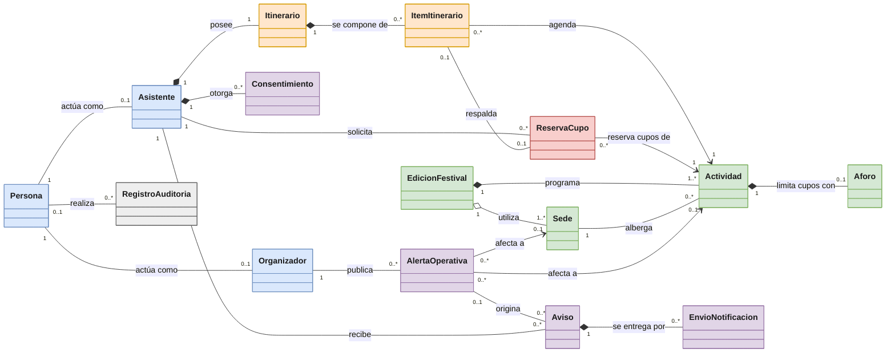
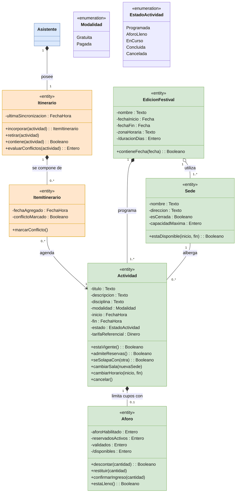
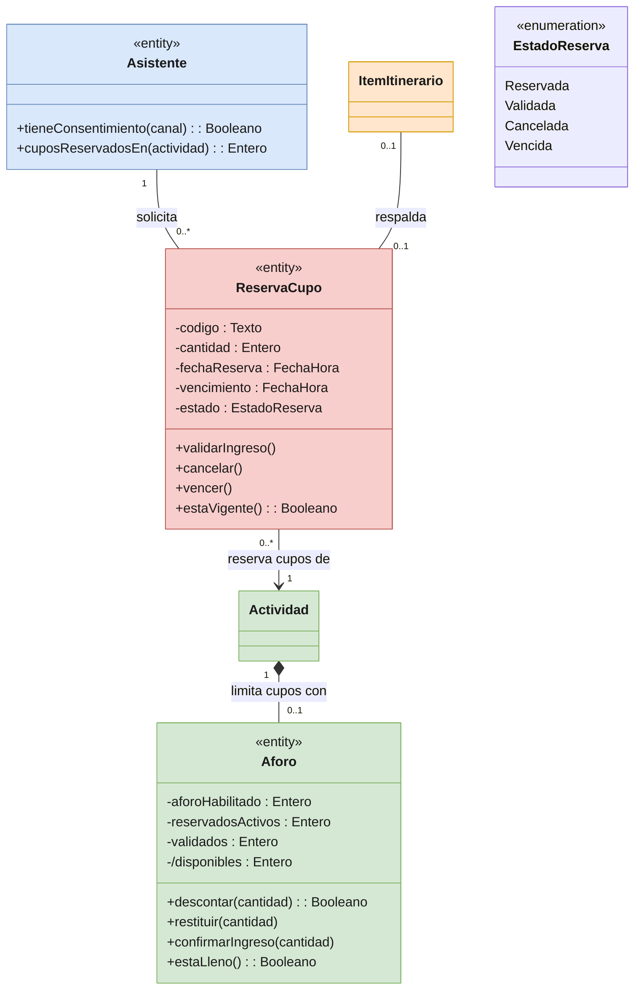
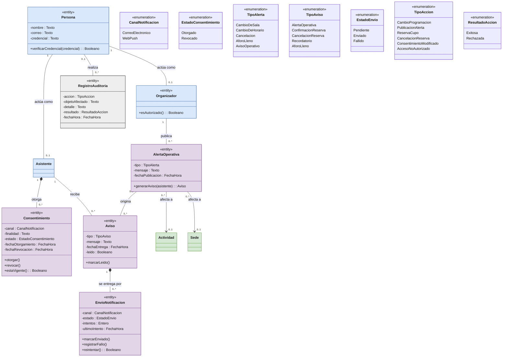
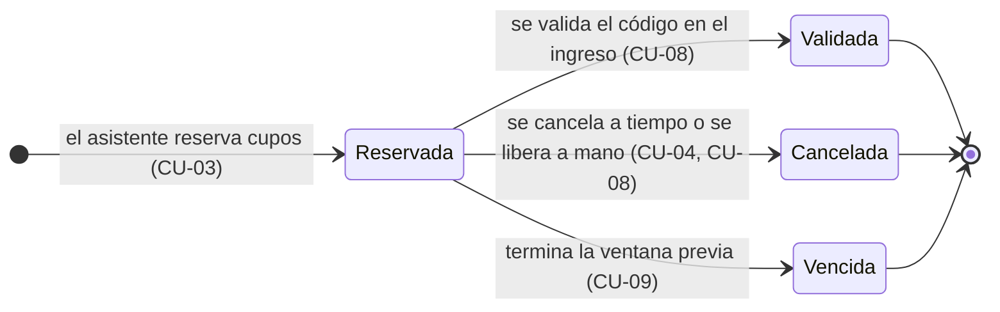
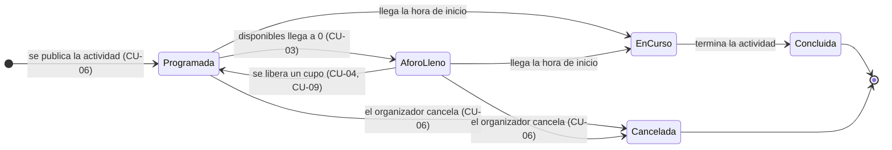

# Vista Lógica: Entidades, Relaciones y Diccionario de Clases — FIAVL

- **Sección del DAS:** Sección 4 — Vista Lógica del Modelo 4+1 de Kruchten
- **Sistema de Interés:** Gestor de Programación e Itinerarios Urbanos del Festival Internacional de Artes Vivas de Loja (FIAVL)
- **Rama de trabajo:** `arch/alex/02-vista-logica`
- **Entradas SDD trazadas:** [`specs/000-tdr/tdr-y-requisitos.md`](../../specs/000-tdr/tdr-y-requisitos.md) (`RU`, `RF`, `SUP-01..08`), [`00-overview-42010.md`](./00-overview-42010.md) (`RNF-01..05`, `RSK-01..06`) y [`01-scenarios-view.md`](./01-scenarios-view.md) (`CU-01..CU-11`, significativos `CU-02`, `CU-03`, `CU-07`)
- **Marco normativo:** `AGENTS.md` (R4 pureza lógica, R6 Mermaid), `GUIA_METODOLOGICA_DAS.md` §4 y §8, UML 2.5.1, ISO/IEC/IEEE 42010
- **Versiones editables (draw.io):** [`drawio/02-logical-view.drawio`](./drawio/02-logical-view.drawio) (2 páginas: conceptual y especificación) con exportaciones [conceptual](./drawio/02-logical-view-conceptual.png) y [especificación](./drawio/02-logical-view-specification.png)

---

## 1. Qué es esta vista y cómo leerla

La Vista Lógica responde una sola pregunta: **¿qué cosas existen en el festival y cómo se relacionan?** Es el "vocabulario" del negocio. Todo lo que aquí aparece sale de los casos de uso de la Vista +1 y, más adelante, será la lista de `«entity»` que usarán los diagramas de secuencia de la Vista de Procesos.

**Cómo leer los diagramas (sin saber UML):**

| Si ves… | Léelo como… |
| :-- | :-- |
| Un recuadro | Una cosa que el sistema debe recordar (una *clase*). |
| Una línea con verbo (*posee*, *reserva cupos de*) | "A *verbo* B". |
| Números en los extremos (`1`, `0..1`, `0..*`, `1..*`) | Cuántos: exactamente uno, ninguno o uno, cualquier cantidad, al menos uno. |
| Rombo relleno ◆ | "Es parte de, y desaparece con el todo". |
| Rombo vacío ◇ | "Agrupa partes que siguen existiendo solas". |
| Un color | El paquete lógico al que pertenece la clase. |

**Paquetes lógicos (6):** *Identidad* (azul), *Programación* (verde), *Mi itinerario* (naranja), *Reservas* (rojo), *Avisos y consentimiento* (morado) y *Auditoría* (gris).

**Frontera de pureza (R4):** esta vista **no** contiene tablas SQL, `PK`/`FK`, tipos de motor, pantallas, botones, rutas, DTO, hilos ni carpetas de código. Los tipos (`Texto`, `Entero`, `FechaHora`…) son abstractos.

---

## 2. Panorama conceptual (Diagrama 1)

Vista de pájaro: las 15 clases del dominio y sus relaciones, sin detalles. Si solo vas a mirar un diagrama, mira este.

**Lectura en voz alta (flujo del festival):** una `Persona` actúa como `Asistente` y/o `Organizador`. El `Organizador` mantiene la programación (`EdicionFestival` programa `Actividad`, que ocurre en una `Sede`) y publica `AlertaOperativa`. El `Asistente` posee un `Itinerario` formado por `ItemItinerario` que agendan `Actividad`, solicita `ReservaCupo` en actividades pagadas (cuyo `Aforo` limita los cupos), otorga `Consentimiento` y recibe `Aviso`, que se entrega por `EnvioNotificacion`. Toda acción relevante deja un `RegistroAuditoria`.

---

## 3. Decodificación gramatical y depuración de entidades

Se leyeron los casos significativos (`CU-02`, `CU-03`, `CU-07`) y el catálogo completo (`CU-01..CU-11`), sin tomar nada de fuera del TDR.

### 3.1 Extracción

| Categoría | Hallazgos (frases del texto) | Destino |
| :-- | :-- | :-- |
| **Sustantivos** | asistente, organizador, cartelera, actividad, función, sede, itinerario, reserva, cupo, aforo, consentimiento, alerta, aviso, bandeja, notificación, auditoría, edición, código, credencial, tarifa | Clases o atributos (ver 3.2 y 3.3) |
| **Verbos** | explorar, incorporar, retirar, reservar, cancelar, validar, liberar, publicar, otorgar, revocar, autenticar, enviar, reintentar | Operaciones (`incorporar`, `cancelar`…) y nombres de relación (*posee*, *publica*, *recibe*) |
| **Adjetivos / estados** | programada, aforo lleno, cancelada, concluida, reservada, validada, vencida, pendiente, enviado, fallido, gratuita, pagada, vigente | `«enumeration»` y diagramas de estado (§5.3) |
| **Cantidades** | 10 días, 2 cupos por función, 5 USD, 30 minutos antes, `disponibles == 0`, “al menos una actividad” | Multiplicidades, atributos y reglas `RN-xx` |

### 3.2 Descartes inmediatos

| Candidato | Motivo del descarte | Dónde queda |
| :-- | :-- | :-- |
| Servicio de Mensajería, Tiempo | Actores externos de la Vista +1; su historia no se guarda | Solo como actores; el intento de entrega sí se guarda en `EnvioNotificacion` |
| Función, evento, espectáculo | **Sinónimos** | Se unifican en `Actividad` (la *función* es una actividad pagada) |
| Recorrido, agenda | Sinónimos | `Itinerario` |
| Sala, teatro, escenario | Sinónimos de lugar | `Sede` (`esCerrada` distingue teatros) |
| Comprobante, constancia | Sinónimos de mensaje al asistente | `Aviso` / `ReservaCupo.codigo` |
| Bitácora | Sinónimo | `RegistroAuditoria` |
| Cartelera | Conjunto de actividades vigentes: es una consulta, no una cosa | Operación de exploración (`CU-01`) |
| Búsqueda, filtro | Operación disfrazada de sustantivo | Proceso de `CU-01` |
| Bandeja | Pantalla / colección de `Aviso` | `Asistente` *recibe* `Aviso` |
| Credencial, código, tarifa, plazo | Dato simple de otra clase | Atributos (`Persona.credencial`, `ReservaCupo.codigo`, `Actividad.tarifaReferencial`, `ReservaCupo.vencimiento`) |
| Cola, *worker*, caché local, PWA | Infraestructura, no negocio | Vistas de Procesos, Desarrollo y Despliegue |

### 3.3 Árbol de 4 Filtros

Filtro 1: ¿se recuerda a largo plazo? · Filtro 2: ¿tiene más de un atributo relevante? · Filtro 3: ¿tiene identidad y ciclo de vida propios? · Filtro 4: ¿participa en un escenario priorizado?

| Candidato | F1 | F2 | F3 | F4 | Decisión |
| :-- | :-: | :-: | :-: | :-: | :-- |
| Persona | ✔ | ✔ | ✔ | ✔ | **Clase** |
| Asistente, Organizador | ✔ | ✔* | ✔ | ✔ | **Clases (roles)**; \*sus datos viven en `Persona` y solo aportan comportamiento y relaciones |
| Consentimiento | ✔ | ✔ | ✔ | ✔ | **Clase** |
| EdicionFestival | ✔ | ✔ | ✔ | ✔ | **Clase** |
| Sede | ✔ | ✔ | ✔ | ✔ | **Clase** |
| Actividad | ✔ | ✔ | ✔ | ✔ | **Clase** |
| Aforo | ✔ | ✔ | ✔ | ✔ | **Clase** (invariante crítica `RSK-01`) |
| Itinerario, ItemItinerario | ✔ | ✔ | ✔ | ✔ | **Clases** (`ItemItinerario` resuelve el N:M con dato propio) |
| ReservaCupo | ✔ | ✔ | ✔ | ✔ | **Clase** |
| AlertaOperativa, Aviso, EnvioNotificacion | ✔ | ✔ | ✔ | ✔ | **Clases** |
| RegistroAuditoria | ✔ | ✔ | ✔ | ✔ | **Clase** |
| Disciplina | ✔ | ✘ (solo nombre) | — | ✔ | **Atributo** `Actividad.disciplina` |
| Cupo | ✔ | ✘ | — | ✔ | **Atributo** (`cantidad`, `disponibles`) |

**Resultado:** 15 clases y 10 enumeraciones.

---

## 4. Tarjetas CRC y matriz de trazabilidad

### 4.1 Tarjetas CRC (cohesión y acoplamiento)

| Clase | Responsabilidades (lo que sabe / hace) | Colaboradores | Veredicto |
| :-- | :-- | :-- | :-- |
| **Persona** | Conocer sus datos mínimos de identidad; Verificar su credencial | Asistente, Organizador, RegistroAuditoria | Cohesiva (2 resp., 3 colab.) |
| **Asistente** | Saber qué consentimientos tiene vigentes; Contar sus cupos reservados por actividad | Persona, Itinerario, ReservaCupo, Consentimiento, Aviso | Cohesiva (2 resp., 5 colab.) |
| **Organizador** | Representar la autoridad de gestión del festival | Persona, AlertaOperativa | Cohesiva (1 resp., 2 colab.) |
| **Consentimiento** | Registrar si el asistente autoriza un canal; Informar si está vigente | Asistente, EnvioNotificacion | Cohesiva (2 resp., 2 colab.) |
| **EdicionFestival** | Delimitar fechas del festival; Agrupar la programación oficial | Actividad, Sede | Cohesiva (2 resp., 2 colab.) |
| **Sede** | Conocer su ubicación y capacidad; Decidir si está libre en una franja | Actividad, EdicionFestival, AlertaOperativa | Cohesiva (2 resp., 3 colab.) |
| **Actividad** | Conocer su horario, sede y modalidad; Mantener su estado; Detectar cruces con otras actividades | EdicionFestival, Sede, Aforo, ItemItinerario, ReservaCupo, AlertaOperativa | Cohesiva (3 resp., 6 colab.) |
| **Aforo** | Proteger la invariante de aforo; Descontar y devolver cupos | Actividad | Cohesiva (2 resp., 1 colab.) |
| **Itinerario** | Ordenar sus actividades cronológicamente; Evitar duplicados; Evaluar conflictos | Asistente, ItemItinerario, Actividad | Cohesiva (3 resp., 3 colab.) |
| **ItemItinerario** | Vincular itinerario y actividad; Guardar la marca de conflicto | Itinerario, Actividad, ReservaCupo | Cohesiva (2 resp., 3 colab.) |
| **ReservaCupo** | Conocer su código, cantidad y vencimiento; Cambiar de estado | Asistente, Actividad, ItemItinerario, Aforo | Cohesiva (2 resp., 4 colab.) |
| **AlertaOperativa** | Conocer tipo, mensaje y alcance; Generar un aviso por afectado | Organizador, Actividad, Sede, Aviso | Cohesiva (2 resp., 4 colab.) |
| **Aviso** | Guardar el mensaje para el asistente; Saber si fue leído | Asistente, AlertaOperativa, EnvioNotificacion | Cohesiva (2 resp., 3 colab.) |
| **EnvioNotificacion** | Llevar el estado de la entrega externa; Controlar reintentos | Aviso, Consentimiento | Cohesiva (2 resp., 2 colab.) |
| **RegistroAuditoria** | Conservar la huella de una acción | Persona | Cohesiva (1 resp., 1 colab.) |

**Diagnóstico:** ninguna clase supera 3 responsabilidades ni 6 colaboradores; no hay “clase Dios”. `Actividad` y `Asistente` son las más conectadas porque son el centro del negocio, y su lógica pesada se reparte en `Aforo`, `Itinerario` y `ReservaCupo`. Las reglas de *orquestación* (quién llama a quién) no están aquí: serán `«control»` en la Vista de Procesos.

### 4.2 Matriz de trazabilidad Casos de Uso × Clases

| Caso de uso | Persona | Asistente | Organizador | Consentimiento | EdicionFestival | Sede | Actividad | Aforo | Itinerario | ItemItinerario | ReservaCupo | AlertaOperativa | Aviso | EnvioNotificacion | RegistroAuditoria |
| :-- | :-: | :-: | :-: | :-: | :-: | :-: | :-: | :-: | :-: | :-: | :-: | :-: | :-: | :-: | :-: |
| **CU-01** Explorar cartelera oficial |  |  |  |  | ● | ● | ● | ● |  |  |  |  |  |  |  |
| **CU-02** Gestionar itinerario urbano |  | ● |  |  | ● | ● | ● |  | ● | ● |  |  |  |  |  |
| **CU-03** Reservar cupo en función pagada |  | ● |  | ● |  |  | ● | ● | ● | ● | ● |  | ● | ● | ● |
| **CU-04** Cancelar reserva de cupo |  | ● |  | ● |  |  | ● | ● |  |  | ● |  | ● | ● | ● |
| **CU-05** Gestionar consentimiento y avisos |  | ● |  | ● |  |  |  |  |  |  |  |  | ● |  | ● |
| **CU-06** Mantener programación del festival |  |  | ● |  | ● | ● | ● | ● |  |  |  | ● |  |  | ● |
| **CU-07** Publicar alerta operativa |  | ● | ● | ● |  | ● | ● |  | ● | ● | ● | ● | ● | ● | ● |
| **CU-08** Controlar ocupación y validar reservas |  |  | ● |  |  |  | ● | ● |  |  | ● |  |  |  | ● |
| **CU-09** Liberar cupos de reservas vencidas |  |  |  |  |  |  | ● | ● |  |  | ● |  |  |  |  |
| **CU-10** Enviar recordatorios y avisos de aforo lleno |  | ● |  | ● |  |  | ● | ● | ● | ● |  |  | ● | ● |  |
| **CU-11** Autenticar usuario | ● | ● | ● |  |  |  |  |  |  |  |  |  |  |  | ● |

**Validación de cobertura:** las 11 filas tienen al menos una marca y las 15 columnas tienen al menos una marca. No sobra ninguna clase y ningún caso de uso queda sin modelo. (Los `CU` que incluyen `CU-11` o `CU-01` heredan sus clases por `«include»`.)

---

## 5. Modelo UML 2.5.1

### 5.1 Especificación por zonas (Diagramas 2A, 2B y 2C)

El detalle se reparte en tres diagramas pequeños para que cada uno se entienda por sí solo. Las clases con borde pero sin contenido son solo “contexto” (su detalle está en otro diagrama).

#### Diagrama 2A — Programación e itinerario (`CU-01`, `CU-02`, `CU-06`)

#### Diagrama 2B — Reservas y aforo (`CU-03`, `CU-04`, `CU-08`, `CU-09`)

#### Diagrama 2C — Identidad, avisos, consentimiento y auditoría (`CU-05`, `CU-07`, `CU-10`, `CU-11`)

Notación: `-` atributo privado, `+` operación pública, `/` atributo derivado (se calcula, no se guarda), `<<entity>>` clase de dominio, `<<enumeration>>` lista cerrada de valores.

### 5.2 Decisiones de relación

| # | Relación | Multiplicidades | Tipo | Por qué se eligió |
| :-: | :-- | :-- | :-- | :-- |
| 1 | `Persona` — *actúa como* → `Asistente` | `1` : `0..1` | Asociación | Patrón de Roles: una persona puede ser asistente y organizador a la vez; la herencia lo impediría. |
| 2 | `Persona` — *actúa como* → `Organizador` | `1` : `0..1` | Asociación | Ídem. Rol Organizador solo existe si la persona es autorizada (RN-01). |
| 3 | `Asistente` — *posee* → `Itinerario` | `1` : `1` | Composición ◆ | El itinerario no tiene sentido sin su dueño: si el asistente se elimina, desaparece. |
| 4 | `Itinerario` — *se compone de* → `ItemItinerario` | `1` : `0..*` | Composición ◆ | Cada ítem existe solo dentro de su itinerario. |
| 5 | `ItemItinerario` — *agenda* → `Actividad` | `0..*` : `1` | Asociación dirigida | Asociación *muchos-a-muchos* Itinerario↔Actividad con dato propio (`conflictoMarcado`) → entidad intermedia `ItemItinerario`. |
| 6 | `Asistente` — *solicita* → `ReservaCupo` | `1` : `0..*` | Asociación | Un asistente puede reservar en varias actividades; la reserva es nominal. |
| 7 | `ReservaCupo` — *reserva cupos de* → `Actividad` | `0..*` : `1` | Asociación dirigida | Asociación *muchos-a-muchos* Asistente↔Actividad con datos propios (código, cantidad, vencimiento) → entidad intermedia `ReservaCupo`. |
| 8 | `ItemItinerario` — *respalda* → `ReservaCupo` | `0..1` : `0..1` | Asociación | Una reserva puede estar vinculada a un ítem del itinerario (CU-03, paso 7); no toda actividad agendada tiene reserva. |
| 9 | `EdicionFestival` — *programa* → `Actividad` | `1` : `1..*` | Composición ◆ | Sin edición no hay actividades: la edición es el todo fuerte. |
| 10 | `EdicionFestival` — *utiliza* → `Sede` | `1` : `1..*` | Agregación ◇ | Las sedes sobreviven a una edición y pueden reutilizarse: agregación, no composición. |
| 11 | `Sede` — *alberga* → `Actividad` | `1` : `0..*` | Asociación | Una actividad ocurre en una sola sede; una sede alberga muchas actividades (RN-04). |
| 12 | `Actividad` — *limita cupos con* → `Aforo` | `1` : `0..1` | Composición ◆ | El aforo no existe sin la actividad pagada; las gratuitas no tienen aforo (RN-07). |
| 13 | `Asistente` — *otorga* → `Consentimiento` | `1` : `0..*` | Composición ◆ | El consentimiento pertenece a un asistente concreto y se elimina con él (LOPDP). |
| 14 | `Organizador` — *publica* → `AlertaOperativa` | `1` : `0..*` | Asociación | Un organizador publica muchas alertas; cada alerta tiene un solo autor. |
| 15 | `AlertaOperativa` — *afecta a* → `Actividad` | `0..*` : `0..1` | Asociación dirigida | El alcance de una alerta es una actividad **o** una sede (exactamente una de las dos). |
| 16 | `AlertaOperativa` — *afecta a* → `Sede` | `0..*` : `0..1` | Asociación dirigida | Ídem. |
| 17 | `AlertaOperativa` — *origina* → `Aviso` | `0..1` : `0..*` | Asociación | Un aviso puede nacer de una alerta o de una reserva/recordatorio; por eso `0..1`. |
| 18 | `Asistente` — *recibe* → `Aviso` | `1` : `0..*` | Asociación | Cada asistente tiene su propia bandeja; un aviso es de un solo asistente. |
| 19 | `Aviso` — *se entrega por* → `EnvioNotificacion` | `1` : `0..*` | Composición ◆ | Un envío externo no tiene sentido sin su aviso; puede haber uno por canal consentido. |
| 20 | `Persona` — *realiza* → `RegistroAuditoria` | `0..1` : `0..*` | Asociación | El actor puede ser desconocido en un intento no autorizado (CU-07, 2a), por eso `0..1`. |

**Patrón de Roles por Asociación:** `Persona` se asocia con `0..1` `Asistente` y `0..1` `Organizador` en lugar de heredar de ellos. Así una misma persona puede ser ambas cosas sin duplicar datos (`RN-01`).

**Muchos-a-muchos resueltos con entidad intermedia (con datos propios):**

| Relación N:M original | Entidad intermedia | Datos propios |
| :-- | :-- | :-- |
| Itinerario ↔ Actividad | `ItemItinerario` | `fechaAgregado`, `conflictoMarcado` |
| Asistente ↔ Actividad | `ReservaCupo` | `codigo`, `cantidad`, `vencimiento`, `estado` |
| Asistente ↔ AlertaOperativa | `Aviso` | `leido`, `fechaEntrega`, `tipo` |

### 5.3 Ciclos de vida (Diagramas 3 y 4)

#### Diagrama 3 — `ReservaCupo`

#### Diagrama 4 — `Actividad`

`AforoLleno` solo aplica a actividades con `Aforo` (pagadas), y se activa automáticamente cuando `disponibles` llega a 0 (`RN-08`).

### 5.4 Enumeraciones

| `«enumeration»` | Valores |
| :-- | :-- |
| `Modalidad` | Gratuita, Pagada |
| `EstadoActividad` | Programada, AforoLleno, EnCurso, Concluida, Cancelada |
| `EstadoReserva` | Reservada, Validada, Cancelada, Vencida |
| `CanalNotificacion` | CorreoElectronico, WebPush |
| `EstadoConsentimiento` | Otorgado, Revocado |
| `TipoAlerta` | CambioDeSala, CambioDeHorario, Cancelacion, AforoLleno, AvisoOperativo |
| `TipoAviso` | AlertaOperativa, ConfirmacionReserva, CancelacionReserva, Recordatorio, AforoLleno |
| `EstadoEnvio` | Pendiente, Enviado, Fallido |
| `TipoAccion` | CambioProgramacion, PublicacionAlerta, ReservaCupo, CancelacionReserva, ConsentimientoModificado, AccesoNoAutorizado |
| `ResultadoAccion` | Exitosa, Rechazada |

---

## 6. Diccionario de clases

### 6.0 Reglas de negocio e invariantes (`RN-xx`)

| ID | Regla de negocio / invariante | Clases |
| :-- | :-- | :-- |
| **RN-01** | Toda persona actúa al menos como Asistente u Organizador; puede tener ambos roles a la vez. | `Persona`, `Asistente`, `Organizador` |
| **RN-02** | La credencial se guarda protegida y el correo identifica a una sola persona (SUP-07). | `Persona` |
| **RN-03** | Ningún aviso sale por un canal externo sin un Consentimiento Otorgado y vigente para ese canal (RF-09, SUP-07). | `Consentimiento`, `EnvioNotificacion` |
| **RN-04** | Toda actividad pertenece a una sola edición y a una sola sede; sus fechas caen dentro de los 10 días de la edición, en zona America/Guayaquil (SUP-08). | `EdicionFestival`, `Actividad` |
| **RN-05** | Dos actividades no pueden ocupar la misma sede cerrada en franjas que se cruzan (RF-11). | `Sede`, `Actividad` |
| **RN-06** | Aforo: reservadosActivos + validados + disponibles = aforoHabilitado, y aforoHabilitado <= capacidad de la sede; disponibles nunca es negativo (RNF-04). | `Aforo`, `ReservaCupo` |
| **RN-07** | Solo las actividades pagadas en teatro cerrado tienen Aforo; las gratuitas no consumen cupo (SUP-04). | `Actividad`, `Aforo` |
| **RN-08** | Cuando disponibles llega a 0 la actividad pasa a AforoLleno; al liberarse un cupo vuelve a Programada (SUP-06). | `Actividad`, `Aforo` |
| **RN-09** | Un asistente no puede tener más de 2 cupos activos por actividad (valor configurable, SUP-01). | `Asistente`, `ReservaCupo` |
| **RN-10** | Se reserva solo en actividades Programadas y antes del plazo previo; la reserva vence 30 minutos antes del inicio (valor configurable, SUP-01). | `Actividad`, `ReservaCupo` |
| **RN-11** | El código de una reserva es único y permite verificarla en el ingreso. | `ReservaCupo` |
| **RN-12** | Una actividad no puede aparecer dos veces en el mismo itinerario. | `Itinerario`, `ItemItinerario` |
| **RN-13** | Un cruce de horario o traslado insuficiente genera advertencia y marca de conflicto; no impide guardar una actividad gratuita (SUP-04). | `Itinerario`, `ItemItinerario` |
| **RN-14** | Una alerta por cancelación llega al 100 % de los titulares de reservas vigentes (RF-12). | `AlertaOperativa` |
| **RN-15** | Todo aviso queda en la bandeja del asistente; la entrega externa es asíncrona y su fallo nunca revierte reservas ni programación (SUP-05). | `AlertaOperativa`, `Aviso`, `EnvioNotificacion` |
| **RN-16** | Los registros de auditoría y las alertas publicadas no se editan ni se borran (RNF-03). | `Consentimiento`, `AlertaOperativa`, `RegistroAuditoria` |
| **RN-17** | Una reserva solo se cancela si está Reservada y dentro del plazo; al cancelar, los cupos regresan al aforo. | `ReservaCupo` |

### 6.1 `Persona` — paquete *Identidad*

**Propósito:** Ser humano que usa la plataforma. Concentra los datos mínimos de identidad (LOPDP) y es la base de los roles Asistente y Organizador.

| Atributo | Tipo | Obligatorio | Restricción |
| :-- | :-- | :-: | :-- |
| `nombre` | `Texto` | Sí | No vacío |
| `correo` | `Texto` | Sí | Formato de correo válido; único por persona |
| `credencial` | `Texto` | Sí | Se conserva protegida; nunca se muestra ni se audita en claro |

| Operación | Entrada | Salida | Propósito |
| :-- | :-- | :-- | :-- |
| `verificarCredencial` | credencial | Booleano | Comprueba la identidad antes de operar (CU-11). |

**Multiplicidades exactas:**

- Cada `Persona` se relaciona con **0..1** `Asistente` (*actúa como*, asociación); cada `Asistente` con **1** `Persona`.
- Cada `Persona` se relaciona con **0..1** `Organizador` (*actúa como*, asociación); cada `Organizador` con **1** `Persona`.
- Cada `Persona` se relaciona con **0..*** `RegistroAuditoria` (*realiza*, asociación); cada `RegistroAuditoria` con **0..1** `Persona`.

**Invariantes y reglas de negocio:** `RN-01`, `RN-02` (ver §6.0).

**Casos de uso trazados:** `CU-11`.

### 6.2 `Asistente` — paquete *Identidad*

**Propósito:** Rol de quien visita el festival: arma su itinerario, reserva cupos y recibe avisos.

*Sin atributos propios: el rol no guarda más datos que los de `Persona`.*

| Operación | Entrada | Salida | Propósito |
| :-- | :-- | :-- | :-- |
| `tieneConsentimiento` | canal | Booleano | Indica si hay consentimiento vigente para ese canal externo. |
| `cuposReservadosEn` | actividad | Entero | Suma sus cupos activos en una actividad (para el límite RN-09). |

**Multiplicidades exactas:**

- Cada `Asistente` se relaciona con **1** `Persona` (*actúa como*, asociación); cada `Persona` con **0..1** `Asistente`.
- Cada `Asistente` se relaciona con **1** `Itinerario` (*posee*, composición); cada `Itinerario` con **1** `Asistente`.
- Cada `Asistente` se relaciona con **0..*** `ReservaCupo` (*solicita*, asociación); cada `ReservaCupo` con **1** `Asistente`.
- Cada `Asistente` se relaciona con **0..*** `Consentimiento` (*otorga*, composición); cada `Consentimiento` con **1** `Asistente`.
- Cada `Asistente` se relaciona con **0..*** `Aviso` (*recibe*, asociación); cada `Aviso` con **1** `Asistente`.

**Invariantes y reglas de negocio:** `RN-01`, `RN-09` (ver §6.0).

**Casos de uso trazados:** `CU-02`, `CU-03`, `CU-04`, `CU-05`, `CU-07`, `CU-10`, `CU-11`.

### 6.3 `Organizador` — paquete *Identidad*

**Propósito:** Rol de quien gestiona el festival: mantiene la programación, controla ocupación y publica alertas.

*Sin atributos propios: el rol no guarda más datos que los de `Persona`.*

| Operación | Entrada | Salida | Propósito |
| :-- | :-- | :-- | :-- |
| `esAutorizado` | — | Booleano | Confirma el rol de gestión antes de cualquier cambio administrativo (CU-11). |

**Multiplicidades exactas:**

- Cada `Organizador` se relaciona con **1** `Persona` (*actúa como*, asociación); cada `Persona` con **0..1** `Organizador`.
- Cada `Organizador` se relaciona con **0..*** `AlertaOperativa` (*publica*, asociación); cada `AlertaOperativa` con **1** `Organizador`.

**Invariantes y reglas de negocio:** `RN-01` (ver §6.0).

**Casos de uso trazados:** `CU-06`, `CU-07`, `CU-08`, `CU-11`.

### 6.4 `Consentimiento` — paquete *Avisos y consentimiento*

**Propósito:** Autorización explícita del Asistente para recibir avisos fuera de la plataforma por un canal concreto (LOPDP 2021).

| Atributo | Tipo | Obligatorio | Restricción |
| :-- | :-- | :-: | :-- |
| `canal` | `CanalNotificacion` | Sí | Correo o Web Push |
| `finalidad` | `Texto` | Sí | Describe para qué se usará el canal |
| `estado` | `EstadoConsentimiento` | Sí | Otorgado o Revocado |
| `fechaOtorgamiento` | `FechaHora` | Sí | No futura |
| `fechaRevocacion` | `FechaHora` | No | Solo si está Revocado; posterior al otorgamiento |

| Operación | Entrada | Salida | Propósito |
| :-- | :-- | :-- | :-- |
| `otorgar` | — | — | Deja el consentimiento como Otorgado. |
| `revocar` | — | — | Deja el consentimiento como Revocado. |
| `estaVigente` | — | Booleano | Responde si permite enviar avisos externos hoy. |

**Multiplicidades exactas:**

- Cada `Consentimiento` se relaciona con **1** `Asistente` (*otorga*, composición); cada `Asistente` con **0..*** `Consentimiento`.

**Invariantes y reglas de negocio:** `RN-03`, `RN-16` (ver §6.0).

**Casos de uso trazados:** `CU-03`, `CU-04`, `CU-05`, `CU-07`, `CU-10`.

### 6.5 `EdicionFestival` — paquete *Programación*

**Propósito:** Edición vigente del FIAVL (10 días). Delimita fechas válidas y zona horaria de toda la programación.

| Atributo | Tipo | Obligatorio | Restricción |
| :-- | :-- | :-: | :-- |
| `nombre` | `Texto` | Sí | No vacío |
| `fechaInicio` | `Fecha` | Sí | Anterior a fechaFin |
| `fechaFin` | `Fecha` | Sí | Duración total de 10 días |
| `zonaHoraria` | `Texto` | Sí | America/Guayaquil (SUP-08) |
| `/duracionDias` | `Entero` | Derivado | fechaFin - fechaInicio + 1 |

| Operación | Entrada | Salida | Propósito |
| :-- | :-- | :-- | :-- |
| `contieneFecha` | fecha | Booleano | Verifica que una fecha pertenezca a la edición. |

**Multiplicidades exactas:**

- Cada `EdicionFestival` se relaciona con **1..*** `Actividad` (*programa*, composición); cada `Actividad` con **1** `EdicionFestival`.
- Cada `EdicionFestival` se relaciona con **1..*** `Sede` (*utiliza*, agregación); cada `Sede` con **1** `EdicionFestival`.

**Invariantes y reglas de negocio:** `RN-04` (ver §6.0).

**Casos de uso trazados:** `CU-01`, `CU-02`, `CU-06`.

### 6.6 `Sede` — paquete *Programación*

**Propósito:** Lugar urbano donde ocurren actividades: plaza, calle o teatro cerrado.

| Atributo | Tipo | Obligatorio | Restricción |
| :-- | :-- | :-: | :-- |
| `nombre` | `Texto` | Sí | Único dentro de la edición |
| `direccion` | `Texto` | Sí | Referencia ubicable en la ciudad |
| `esCerrada` | `Booleano` | Sí | Verdadero para teatros con aforo físico |
| `capacidadMaxima` | `Entero` | Solo si es cerrada | Mayor que 0; techo físico del aforo |

| Operación | Entrada | Salida | Propósito |
| :-- | :-- | :-- | :-- |
| `estaDisponible` | inicio, fin | Booleano | Verifica que no haya otra actividad en esa franja (RN-05). |

**Multiplicidades exactas:**

- Cada `Sede` se relaciona con **1** `EdicionFestival` (*utiliza*, agregación); cada `EdicionFestival` con **1..*** `Sede`.
- Cada `Sede` se relaciona con **0..*** `Actividad` (*alberga*, asociación); cada `Actividad` con **1** `Sede`.
- Cada `Sede` se relaciona con **0..*** `AlertaOperativa` (*afecta a*, asociación); cada `AlertaOperativa` con **0..1** `Sede`.

**Invariantes y reglas de negocio:** `RN-05` (ver §6.0).

**Casos de uso trazados:** `CU-01`, `CU-02`, `CU-06`, `CU-07`.

### 6.7 `Actividad` — paquete *Programación*

**Propósito:** Evento oficial de la cartelera (espectáculo, función, taller). Si es pagada, es una función de teatro cerrado con aforo limitado.

| Atributo | Tipo | Obligatorio | Restricción |
| :-- | :-- | :-: | :-- |
| `titulo` | `Texto` | Sí | No vacío |
| `descripcion` | `Texto` | No | — |
| `disciplina` | `Texto` | Sí | Valor del catálogo artístico del festival |
| `modalidad` | `Modalidad` | Sí | Gratuita o Pagada |
| `inicio` | `FechaHora` | Sí | Dentro de la edición |
| `fin` | `FechaHora` | Sí | Posterior a inicio |
| `estado` | `EstadoActividad` | Sí | Ver diagrama de estados |
| `tarifaReferencial` | `Dinero` | Solo si es pagada | 5 USD referencial; sin cobro en línea |

| Operación | Entrada | Salida | Propósito |
| :-- | :-- | :-- | :-- |
| `estaVigente` | — | Booleano | No cancelada ni concluida. |
| `admiteReservas` | — | Booleano | Pagada, Programada y dentro del plazo previo. |
| `seSolapaCon` | otra | Booleano | Detecta cruce horario con otra actividad. |
| `cambiarSala` | nuevaSede | — | Mueve la actividad a otra sede (RN-05). |
| `cambiarHorario` | inicio, fin | — | Reprograma la actividad (RN-05). |
| `cancelar` | — | — | Pasa a Cancelada. |

**Multiplicidades exactas:**

- Cada `Actividad` se relaciona con **0..*** `ItemItinerario` (*agenda*, asociación); cada `ItemItinerario` con **1** `Actividad`.
- Cada `Actividad` se relaciona con **0..*** `ReservaCupo` (*reserva cupos de*, asociación); cada `ReservaCupo` con **1** `Actividad`.
- Cada `Actividad` se relaciona con **1** `EdicionFestival` (*programa*, composición); cada `EdicionFestival` con **1..*** `Actividad`.
- Cada `Actividad` se relaciona con **1** `Sede` (*alberga*, asociación); cada `Sede` con **0..*** `Actividad`.
- Cada `Actividad` se relaciona con **0..1** `Aforo` (*limita cupos con*, composición); cada `Aforo` con **1** `Actividad`.
- Cada `Actividad` se relaciona con **0..*** `AlertaOperativa` (*afecta a*, asociación); cada `AlertaOperativa` con **0..1** `Actividad`.

**Invariantes y reglas de negocio:** `RN-04`, `RN-05`, `RN-07`, `RN-08`, `RN-10` (ver §6.0).

**Casos de uso trazados:** `CU-01`, `CU-02`, `CU-03`, `CU-04`, `CU-06`, `CU-07`, `CU-08`, `CU-09`, `CU-10`.

### 6.8 `Aforo` — paquete *Programación*

**Propósito:** Control de cupos de una actividad pagada. Garantiza que nunca se venda más de lo que cabe en la sala.

| Atributo | Tipo | Obligatorio | Restricción |
| :-- | :-- | :-: | :-- |
| `aforoHabilitado` | `Entero` | Sí | Mayor que 0 y menor o igual a la capacidad de la sede |
| `reservadosActivos` | `Entero` | Sí | Mayor o igual a 0 |
| `validados` | `Entero` | Sí | Mayor o igual a 0 |
| `/disponibles` | `Entero` | Derivado | aforoHabilitado - reservadosActivos - validados; nunca negativo |

| Operación | Entrada | Salida | Propósito |
| :-- | :-- | :-- | :-- |
| `descontar` | cantidad | Booleano | Aparta cupos si alcanzan; si no, rechaza sin cambiar nada. |
| `restituir` | cantidad | — | Devuelve cupos de una reserva cancelada o vencida. |
| `confirmarIngreso` | cantidad | — | Pasa cupos de reservados a validados. |
| `estaLleno` | — | Booleano | Verdadero cuando disponibles es 0. |

**Multiplicidades exactas:**

- Cada `Aforo` se relaciona con **1** `Actividad` (*limita cupos con*, composición); cada `Actividad` con **0..1** `Aforo`.

**Invariantes y reglas de negocio:** `RN-06`, `RN-07`, `RN-08` (ver §6.0).

**Casos de uso trazados:** `CU-01`, `CU-03`, `CU-04`, `CU-06`, `CU-08`, `CU-09`, `CU-10`.

### 6.9 `Itinerario` — paquete *Mi itinerario*

**Propósito:** Recorrido personal del Asistente por la ciudad, ordenado por día y hora.

| Atributo | Tipo | Obligatorio | Restricción |
| :-- | :-- | :-: | :-- |
| `ultimaSincronizacion` | `FechaHora` | No | No futura; indica la última vez que se sincronizó para lectura en calle |

| Operación | Entrada | Salida | Propósito |
| :-- | :-- | :-- | :-- |
| `incorporar` | actividad | ItemItinerario | Agrega una actividad vigente y no repetida; marca conflicto si lo hay. |
| `retirar` | actividad | — | Quita una actividad del recorrido. |
| `contiene` | actividad | Booleano | Evita duplicados. |
| `evaluarConflictos` | actividad | Entero | Cuenta actividades en cruce o sin margen de traslado. |

**Multiplicidades exactas:**

- Cada `Itinerario` se relaciona con **1** `Asistente` (*posee*, composición); cada `Asistente` con **1** `Itinerario`.
- Cada `Itinerario` se relaciona con **0..*** `ItemItinerario` (*se compone de*, composición); cada `ItemItinerario` con **1** `Itinerario`.

**Invariantes y reglas de negocio:** `RN-12`, `RN-13` (ver §6.0).

**Casos de uso trazados:** `CU-02`, `CU-03`, `CU-07`, `CU-10`.

### 6.10 `ItemItinerario` — paquete *Mi itinerario*

**Propósito:** Una actividad dentro de un itinerario concreto. Resuelve la relación muchos-a-muchos y guarda el dato propio de conflicto.

| Atributo | Tipo | Obligatorio | Restricción |
| :-- | :-- | :-: | :-- |
| `fechaAgregado` | `FechaHora` | Sí | No futura |
| `conflictoMarcado` | `Booleano` | Sí | Verdadero si el asistente decidió conservar una actividad en cruce |

| Operación | Entrada | Salida | Propósito |
| :-- | :-- | :-- | :-- |
| `marcarConflicto` | — | — | Registra la advertencia aceptada por el asistente. |

**Multiplicidades exactas:**

- Cada `ItemItinerario` se relaciona con **1** `Itinerario` (*se compone de*, composición); cada `Itinerario` con **0..*** `ItemItinerario`.
- Cada `ItemItinerario` se relaciona con **1** `Actividad` (*agenda*, asociación); cada `Actividad` con **0..*** `ItemItinerario`.
- Cada `ItemItinerario` se relaciona con **0..1** `ReservaCupo` (*respalda*, asociación); cada `ReservaCupo` con **0..1** `ItemItinerario`.

**Invariantes y reglas de negocio:** `RN-12`, `RN-13` (ver §6.0).

**Casos de uso trazados:** `CU-02`, `CU-03`, `CU-07`, `CU-10`.

### 6.11 `ReservaCupo` — paquete *Reservas*

**Propósito:** Apartado nominal de cupos de un Asistente en una actividad pagada. El pago de 5 USD se hace en taquilla.

| Atributo | Tipo | Obligatorio | Restricción |
| :-- | :-- | :-: | :-- |
| `codigo` | `Texto` | Sí | Único y verificable |
| `cantidad` | `Entero` | Sí | Entre 1 y el máximo por asistente (2 por defecto) |
| `fechaReserva` | `FechaHora` | Sí | No futura |
| `vencimiento` | `FechaHora` | Sí | Anterior al inicio de la actividad (30 min por defecto) |
| `estado` | `EstadoReserva` | Sí | Ver diagrama de estados |

| Operación | Entrada | Salida | Propósito |
| :-- | :-- | :-- | :-- |
| `validarIngreso` | — | — | Pasa a Validada al canjear el código. |
| `cancelar` | — | — | Pasa a Cancelada si está a tiempo (RN-17). |
| `vencer` | — | — | Pasa a Vencida al cumplirse el plazo. |
| `estaVigente` | — | Booleano | Reservada y antes de su vencimiento. |

**Multiplicidades exactas:**

- Cada `ReservaCupo` se relaciona con **1** `Asistente` (*solicita*, asociación); cada `Asistente` con **0..*** `ReservaCupo`.
- Cada `ReservaCupo` se relaciona con **1** `Actividad` (*reserva cupos de*, asociación); cada `Actividad` con **0..*** `ReservaCupo`.
- Cada `ReservaCupo` se relaciona con **0..1** `ItemItinerario` (*respalda*, asociación); cada `ItemItinerario` con **0..1** `ReservaCupo`.

**Invariantes y reglas de negocio:** `RN-06`, `RN-09`, `RN-10`, `RN-11`, `RN-17` (ver §6.0).

**Casos de uso trazados:** `CU-03`, `CU-04`, `CU-07`, `CU-08`, `CU-09`.

### 6.12 `AlertaOperativa` — paquete *Avisos y consentimiento*

**Propósito:** Comunicado oficial del Organizador por cambio de sala, horario, cancelación, aforo lleno o contingencia.

| Atributo | Tipo | Obligatorio | Restricción |
| :-- | :-- | :-: | :-- |
| `tipo` | `TipoAlerta` | Sí | Uno de los tipos definidos |
| `mensaje` | `Texto` | Sí | No vacío |
| `fechaPublicacion` | `FechaHora` | Sí | Se fija al publicar; no se edita |

| Operación | Entrada | Salida | Propósito |
| :-- | :-- | :-- | :-- |
| `generarAviso` | asistente | Aviso | Crea el aviso en la bandeja de un afectado. |

**Multiplicidades exactas:**

- Cada `AlertaOperativa` se relaciona con **1** `Organizador` (*publica*, asociación); cada `Organizador` con **0..*** `AlertaOperativa`.
- Cada `AlertaOperativa` se relaciona con **0..1** `Actividad` (*afecta a*, asociación); cada `Actividad` con **0..*** `AlertaOperativa`.
- Cada `AlertaOperativa` se relaciona con **0..1** `Sede` (*afecta a*, asociación); cada `Sede` con **0..*** `AlertaOperativa`.
- Cada `AlertaOperativa` se relaciona con **0..*** `Aviso` (*origina*, asociación); cada `Aviso` con **0..1** `AlertaOperativa`.

**Invariantes y reglas de negocio:** `RN-14`, `RN-15`, `RN-16` (ver §6.0).

**Casos de uso trazados:** `CU-06`, `CU-07`.

### 6.13 `Aviso` — paquete *Avisos y consentimiento*

**Propósito:** Mensaje que un Asistente ve en su bandeja: alertas, confirmaciones de reserva, cancelaciones, recordatorios o aforo lleno.

| Atributo | Tipo | Obligatorio | Restricción |
| :-- | :-- | :-: | :-- |
| `tipo` | `TipoAviso` | Sí | Uno de los tipos definidos |
| `mensaje` | `Texto` | Sí | No vacío |
| `fechaEntrega` | `FechaHora` | Sí | No futura |
| `leido` | `Booleano` | Sí | Falso al crearse |

| Operación | Entrada | Salida | Propósito |
| :-- | :-- | :-- | :-- |
| `marcarLeido` | — | — | Registra que el asistente lo vio. |

**Multiplicidades exactas:**

- Cada `Aviso` se relaciona con **0..1** `AlertaOperativa` (*origina*, asociación); cada `AlertaOperativa` con **0..*** `Aviso`.
- Cada `Aviso` se relaciona con **1** `Asistente` (*recibe*, asociación); cada `Asistente` con **0..*** `Aviso`.
- Cada `Aviso` se relaciona con **0..*** `EnvioNotificacion` (*se entrega por*, composición); cada `EnvioNotificacion` con **1** `Aviso`.

**Invariantes y reglas de negocio:** `RN-15` (ver §6.0).

**Casos de uso trazados:** `CU-03`, `CU-04`, `CU-05`, `CU-07`, `CU-10`.

### 6.14 `EnvioNotificacion` — paquete *Avisos y consentimiento*

**Propósito:** Intento de entregar un aviso por un canal externo. Permite reintentar sin afectar reservas ni programación.

| Atributo | Tipo | Obligatorio | Restricción |
| :-- | :-- | :-: | :-- |
| `canal` | `CanalNotificacion` | Sí | Correo o Web Push |
| `estado` | `EstadoEnvio` | Sí | Pendiente, Enviado o Fallido |
| `intentos` | `Entero` | Sí | Mayor o igual a 0; con tope de reintentos |
| `ultimoIntento` | `FechaHora` | No | No futura |

| Operación | Entrada | Salida | Propósito |
| :-- | :-- | :-- | :-- |
| `marcarEnviado` | — | — | Pasa a Enviado. |
| `registrarFallo` | — | — | Suma un intento y pasa a Fallido o sigue Pendiente. |
| `reintentar` | — | Booleano | Indica si aún quedan reintentos. |

**Multiplicidades exactas:**

- Cada `EnvioNotificacion` se relaciona con **1** `Aviso` (*se entrega por*, composición); cada `Aviso` con **0..*** `EnvioNotificacion`.

**Invariantes y reglas de negocio:** `RN-03`, `RN-15` (ver §6.0).

**Casos de uso trazados:** `CU-03`, `CU-04`, `CU-07`, `CU-10`.

### 6.15 `RegistroAuditoria` — paquete *Auditoría*

**Propósito:** Huella inmutable de una acción relevante: cambios de programación, reservas, alertas, consentimientos e intentos no autorizados.

| Atributo | Tipo | Obligatorio | Restricción |
| :-- | :-- | :-: | :-- |
| `accion` | `TipoAccion` | Sí | Una de las acciones auditables |
| `objetoAfectado` | `Texto` | Sí | Referencia legible al elemento afectado |
| `detalle` | `Texto` | No | Sin datos sensibles en claro |
| `resultado` | `ResultadoAccion` | Sí | Exitosa o Rechazada |
| `fechaHora` | `FechaHora` | Sí | Fijada por el sistema; nunca se modifica |

*Sin operaciones: es un registro inmutable (RN-16).*

**Multiplicidades exactas:**

- Cada `RegistroAuditoria` se relaciona con **0..1** `Persona` (*realiza*, asociación); cada `Persona` con **0..*** `RegistroAuditoria`.

**Invariantes y reglas de negocio:** `RN-16` (ver §6.0).

**Casos de uso trazados:** `CU-03`, `CU-04`, `CU-05`, `CU-06`, `CU-07`, `CU-08`, `CU-11`.

---

## 7. Verificación por recorrido (*walkthrough*) de los casos significativos

Se comprueba que cada caso significativo se puede “contar” usando solo clases del modelo.

### 7.1 `CU-02` Gestionar itinerario urbano

1. El `Asistente` explora actividades de la edición (`EdicionFestival` programa `Actividad` en una `Sede`; `CU-01`).
2. Al incorporar, el `Itinerario` del asistente verifica con `contiene` que no esté duplicada (`RN-12`) y con `evaluarConflictos` si se cruza con otra (`Actividad.seSolapaCon`, `RN-13`).
3. Se crea un `ItemItinerario` (con `conflictoMarcado` si corresponde) que *agenda* la `Actividad`.
4. `Itinerario.ultimaSincronizacion` se actualiza para la consulta en calle.
5. Si la actividad es pagada, el flujo se extiende a `CU-03` mediante `ReservaCupo`, que *respalda* el `ItemItinerario`.

### 7.2 `CU-03` Reservar cupo en función pagada

1. Se identifica al `Asistente` (`Persona.verificarCredencial`) y se comprueba su `Consentimiento` (`tieneConsentimiento`).
2. `Actividad.admiteReservas` valida estado y plazo (`RN-10`); `Asistente.cuposReservadosEn` valida el límite (`RN-09`).
3. `Aforo.descontar` aparta los cupos o rechaza sin cambiar nada (`RN-06`, `RSK-01`). Si `disponibles` llega a 0, la `Actividad` pasa a `AforoLleno` (`RN-08`).
4. Se crea la `ReservaCupo` en estado `Reservada` con `codigo` único (`RN-11`) y `vencimiento`; se vincula al `ItemItinerario`.
5. Se genera un `Aviso` de confirmación; si hay `Consentimiento` vigente, se crea un `EnvioNotificacion` en estado `Pendiente` (`RN-03`, `RN-15`). Si la mensajería falla, la reserva sigue firme.
6. Se registra un `RegistroAuditoria` (`RN-16`).

### 7.3 `CU-07` Publicar alerta operativa

1. Se autentica al `Organizador` (`esAutorizado`); si falla, solo se crea un `RegistroAuditoria` con resultado `Rechazada`.
2. Se crea la `AlertaOperativa` (alcance: una `Actividad` o una `Sede`).
3. Los afectados son los `Asistente` con esa actividad en su `Itinerario` o con `ReservaCupo` vigente (`RN-14`); a cada uno se le genera un `Aviso` (`generarAviso`).
4. Solo para quienes tienen `Consentimiento` vigente se crea un `EnvioNotificacion` `Pendiente` (`RN-03`); los demás ven el aviso solo en su bandeja.
5. Un fallo externo deja el envío `Fallido` con reintentos, sin revertir la alerta (`RN-15`).
6. La publicación queda en `RegistroAuditoria` (`RN-16`).

---

## 8. Correspondencia con las demás vistas (42010)

| Vista | Qué toma de la Vista Lógica | Estado |
| :-- | :-- | :-- |
| **+1 Escenarios** ([01](./01-scenarios-view.md)) | Cada `CU-xx` ↔ clases según la matriz §4.2; las reglas de los flujos alternos están en `RN-xx` | Trazado completo |
| **Procesos (ECB)** | Las 15 clases son los candidatos a `«entity»`. Los `«boundary»` y `«control»` **no** aparecen aquí (R3). Las operaciones de entidad son invariantes, no orquestación | Pendiente de la Vista de Procesos |
| **Desarrollo** | Los 6 paquetes lógicos son la propuesta de módulos de `Domain` (`identidad`, `programacion`, `itinerario`, `reservas`, `avisos`, `auditoria`). La Vista de Desarrollo decide qué capacidades (p. ej. auditoría, notificaciones) pasan a `Utility` | Propuesta a confirmar (R2, 1:1) |
| **Despliegue** | No aplica directamente; los artefactos manifestarán los paquetes de Desarrollo | Pendiente |

**Insights de la Vista +1 resueltos aquí** (`01-scenarios-view.md` §6):

| Insight | Cómo lo resuelve la Vista Lógica |
| :-- | :-- |
| Exclusión mutua y 0 sobreventas | Invariante `RN-06` en `Aforo` (`descontar` es todo o nada) y estados `AforoLleno` / `Vencida`; el `[critical]` lo modela la Vista de Procesos |
| Desacoplamiento asíncrono ante caída de terceros | `EnvioNotificacion` separado de `Aviso`, con `Pendiente / Enviado / Fallido` (`RN-15`) |
| Lectura en calle (*offline*) vs. mutación consistente | `Itinerario.ultimaSincronizacion` como concepto; la caché es de Plataforma |
| RBAC, auditoría y LOPDP | `Organizador.esAutorizado`, `Consentimiento` por canal (`RN-03`) y `RegistroAuditoria` inmutable (`RN-16`) |

---

## 9. Lista de verificación de la vista

- **R4 (pureza):** sin SQL, `PK`/`FK`, tipos de motor, pantallas, rutas ni DTO; los tipos son abstractos y no hay claves foráneas simuladas como atributos.
- **R6 (Mermaid):** 6 bloques estándar (`classDiagram` ×4, `stateDiagram-v2` ×2), con identificadores ASCII, validados con `mmdc` sin errores.
- **R2 (nombres):** ningún paquete se llama `Common`, `Shared`, `Utils` ni similares.
- **Matriz:** 11/11 casos de uso y 15/15 clases con trazabilidad.
- **Versión draw.io:** [`02-logical-view.drawio`](./drawio/02-logical-view.drawio) contiene los mismos 15 elementos y 20 relaciones que el Diagrama 1 y el detalle de los Diagramas 2A–2C.
