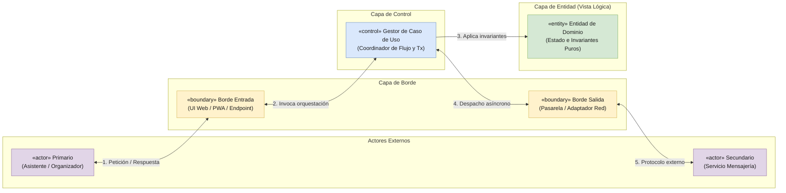
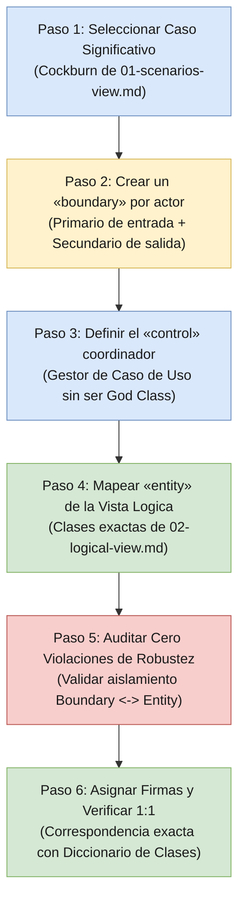
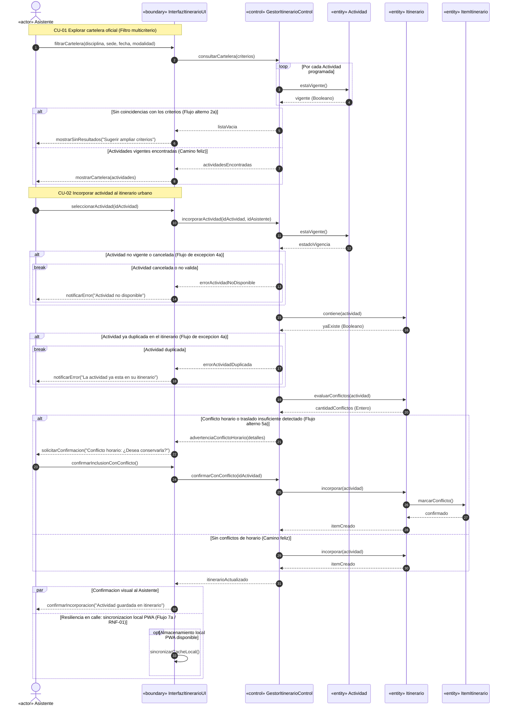
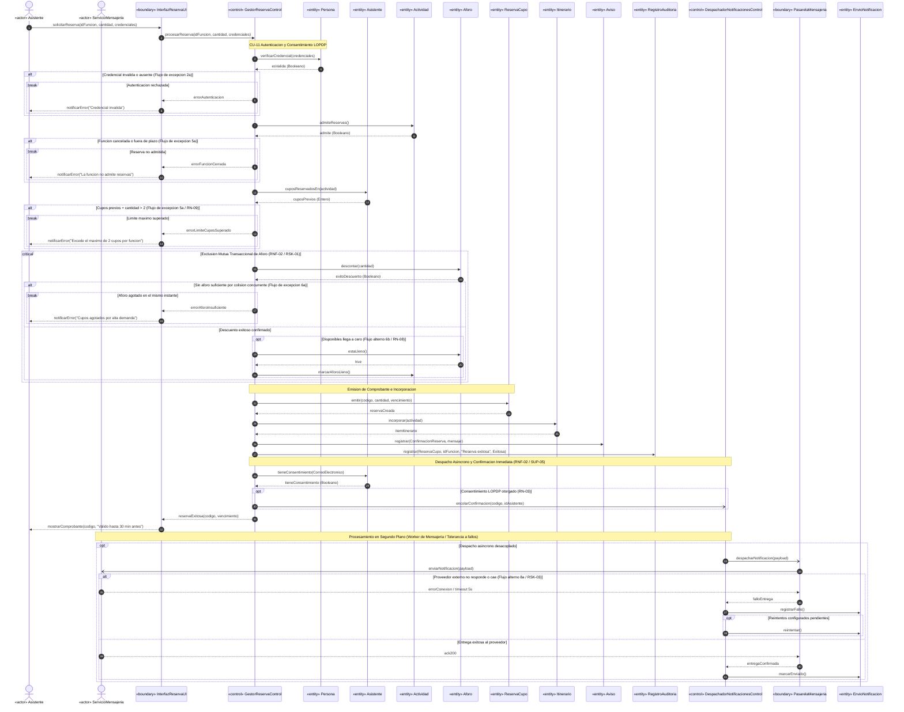
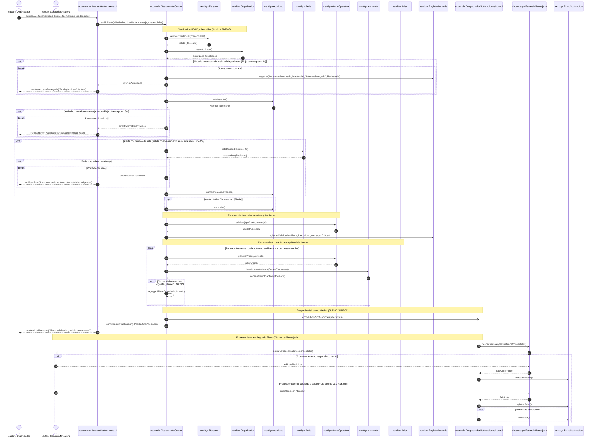
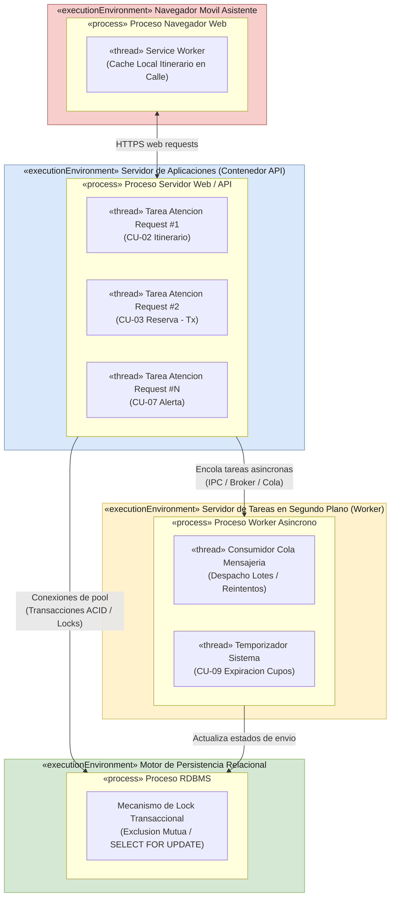

# Vista de Procesos: Patrón ECB, Concurrencia y Diagramas de Secuencia UML 2.5.1 — FIAVL

- **Sección del DAS:** Sección 5 — Vista de Procesos del Modelo 4+1 de Kruchten
- **Sistema de Interés:** Gestor de Programación e Itinerarios Urbanos del Festival Internacional de Artes Vivas de Loja (FIAVL)
- **Rama de trabajo:** `arch/luis/03-vista-procesos`
- **Entradas SDD trazadas:**
  - [`specs/000-tdr/tdr-y-requisitos.md`](../../specs/000-tdr/tdr-y-requisitos.md) (`RU-01`..`RU-09`, `RF-01`..`RF-18`, `SUP-01`..`SUP-08`)
  - [`docs/architecture/00-overview-42010.md`](./00-overview-42010.md) (`INT-01`..`INT-05`, `RNF-01`..`RNF-05`, `RSK-01`..`RSK-06`)
  - [`docs/architecture/01-scenarios-view.md`](./01-scenarios-view.md) (Catálogo `CU-01`..`CU-11`, significativos `CU-02`, `CU-03`, `CU-07`)
  - [`docs/architecture/02-logical-view.md`](./02-logical-view.md) (15 clases `«entity»`, 10 enumeraciones, invariantes `RN-01`..`RN-17`)
- **Marco normativo:** `AGENTS.md` (R3 aislamiento ECB estricto, R6 Mermaid / DeepWiki), `docs/architecture/GUIA_METODOLOGICA_DAS.md` §5 y §8, OMG UML 2.5.1, ISO/IEC/IEEE 42010 e ISO/IEC 25010:2023.

---

## 1. Propósito de la Vista de Procesos y Marco Conceptual ECB

### 1.1 Qué responde esta vista
Mientras la **Vista Lógica** describe la estructura estática (*qué cosas existen en el festival y cómo se relacionan*), la **Vista de Procesos** responde a la pregunta dinámica: **¿cómo colaboran los componentes en el tiempo para cumplir los casos de uso, cómo se gestiona la concurrencia y qué ocurre cuando fallan los servicios externos?**

Esta vista descompone la ejecución del sistema en flujos temporales auditables, especifica los mecanismos de **exclusión mutua** para proteger aforos limitados (`RNF-02`, `RSK-01`), delimita las fronteras entre **comunicación síncrona y asíncrona** (`RNF-02`, `SUP-05`), y mapea los componentes a **procesos y tareas/hilos** asegurando un diseño **sin estado local (*stateless*)** preparado para replicación horizontal (`RNF-05`).

---

### 1.2 El Patrón Entidad-Borde-Control (ECB)
En estricto cumplimiento de la regla **R3** de `AGENTS.md` y la metodología DAS v3.0 (§5), todo flujo dinámico modela la interacción asignando los siguientes estereotipos UML 2.5.1:

#### Responsabilidades formales por estereotipo:
1. **`«boundary»` (Borde):**
   - Encapsula la interacción con actores primarios (captura entrada HTTP/Web PWA, valida sintaxis de transporte y formatea la respuesta visual) o secundarios (adaptadores/clientes hacia pasarelas externas).
   - **Prohibición estricta:** carece de reglas de negocio y **jamás se comunica directamente con una `«entity»`**.
2. **`«control»` (Control):**
   - Orquesta la secuencia del caso de uso, coordina transacciones, invoca las operaciones de las entidades en el orden previsto y gestiona la tolerancia a fallos.
   - **Antipatrón prevenido (*Evitando la "Clase Dios"*):** el controlador no toma decisiones de datos ni almacena estado de dominio; delega toda validación de estado e invariante en las entidades correspondientes.
3. **`«entity»` (Entidad):**
   - Representa las clases conceptuales formalizadas en [`docs/architecture/02-logical-view.md`](./02-logical-view.md).
   - Encapsula estado persistente e invariantes puras (`RN-01`..`RN-17`). Nunca invoca bordes ni plataformas de infraestructura.

---

### 1.3 Matriz de Comunicación ECB y Reglas de Robustez

| Elemento Origen | `«actor»` | `«boundary»` | `«control»` | `«entity»` | Regla Normativa |
| :--- | :---: | :---: | :---: | :---: | :--- |
| **`«actor»`** | ✘ | **PERMITIDO** | ✘ | ✘ | Los actores solo interactúan a través de la frontera de borde. |
| **`«boundary»`** | **PERMITIDO** | ✘ | **PERMITIDO** | **TERMINANTEMENTE PROHIBIDO** | **R3 (`AGENTS.md`):** Todo acceso a entidades debe ser mediado por un control. |
| **`«control»`** | ✘ | **PERMITIDO** | **PERMITIDO** | **PERMITIDO** | El control coordina bordes, delega en otros controles e invoca entidades. |
| **`«entity»`** | ✘ | **TERMINANTEMENTE PROHIBIDO** | ✘ | **PERMITIDO** | Las entidades no conocen controles ni bordes; pueden colaborar entre sí. |

---

### 1.4 Notación UML 2.5.1 en Mermaid (DeepWiki — Regla R6)

Los diagramas de secuencia se modelan en sintaxis estándar Mermaid `sequenceDiagram`, empleando:
- **Líneas de vida explícitas** con estereotipos: `«actor»`, `«boundary»`, `«control»`, `«entity»`.
- **Comunicación Síncrona (`->>` llamada / `-->>` retorno):** el emisor se bloquea en espera de respuesta inmediata (utilizado en validaciones, cálculos de itinerario y transacciones atómicas de aforo).
- **Comunicación Asíncrona (`-)` flecha abierta):** el emisor despacha el mensaje hacia una pasarela/cola desacoplada y continúa sin esperar confirmación externa inmediata (utilizado en notificaciones de correo/push para garantizar tolerancia a fallos bajo `RNF-02`).
- **Fragmentos combinados:**
  - `[alt]`: bifurcación condicional mutuamente excluyente.
  - `[opt]`: paso condicional opcional.
  - `[loop]`: iteración sobre conjuntos o colecciones de dominio.
  - `[break]`: interrupción inmediata ante excepción irrecuperable o fallo de precondición.
  - `[par]`: tareas concurrentes en hilos/procesos paralelos sin dependencia de orden.
  - **`[critical]`:** región de exclusión mutua atómica sobre el aforo de cupos en funciones pagadas.

---

## 2. Procedimiento Metodológico de 6 Pasos (GUIA_METODOLOGICA_DAS.md §5)

Se aplica de forma estricta el procedimiento normativo sobre los tres Casos Arquitectónicamente Significativos (CAS) seleccionados en [`docs/architecture/01-scenarios-view.md`](./01-scenarios-view.md) §4:

---

## 3. Tablas de Identificación ECB y Auditoría de Robustez

### 3.1 Identificación ECB para `CU-02`: Gestionar itinerario urbano (con `CU-01`)

| Elemento | Estereotipo | Tipo / Capa | Responsabilidad Concreta | Justificación Arquitectónica |
| :--- | :---: | :---: | :--- | :--- |
| `Asistente` | `«actor»` | Primario | Solicita filtrar cartelera, incorporar o retirar actividades y sincronizar en calle. | Actor humano en vía pública (`INT-01`, `RU-01`, `RU-02`). |
| `InterfazItinerarioUI` | `«boundary»` | Entrada | Captura selecciones de filtros y eventos en móvil/PWA, valida sintaxis y sincroniza caché local. | Aísla la interfaz de usuario de las reglas del dominio (`RNF-04`). |
| `GestorItinerarioControl` | `«control»` | Aplicación | Orquesta la consulta de cartelera (`CU-01`), valida no duplicidad, detecta conflictos y delega incorporación. | Coordina el flujo sin absorber invariantes de tiempo ni persistencia. |
| `Actividad` | `«entity»` | Dominio | Evalúa su vigencia (`estaVigente`), horario y solapamiento (`seSolapaCon`). | Entidad de [`02-logical-view.md`](./02-logical-view.md) §6.7. |
| `Itinerario` | `«entity»` | Dominio | Mantiene el orden cronológico, valida no repetición (`contiene`) y evalúa conflictos (`evaluarConflictos`). | Entidad de [`02-logical-view.md`](./02-logical-view.md) §6.9 (`RN-12`, `RN-13`). |
| `ItemItinerario` | `«entity»` | Dominio | Registra la inclusión del evento y la marca de advertencia aceptada (`marcarConflicto`). | Entidad de [`02-logical-view.md`](./02-logical-view.md) §6.10. |
| `Sede` | `«entity»` | Dominio | Provee la referencia espacial urbana para estimar márgenes de traslado entre sedes distintas. | Entidad de [`02-logical-view.md`](./02-logical-view.md) §6.6 (`SUP-04`). |

---

### 3.2 Identificación ECB para `CU-03`: Reservar cupo en función pagada

| Elemento | Estereotipo | Tipo / Capa | Responsabilidad Concreta | Justificación Arquitectónica |
| :--- | :---: | :---: | :--- | :--- |
| `Asistente` | `«actor»` | Primario | Solicita reservar cupos en función pagada y recibe código único verificable. | Actor que reserva boleto referencial de 5 USD (`SUP-01`). |
| `ServicioMensajeria` | `«actor»` | Secundario | Proveedor externo receptor de confirmaciones por Correo Electrónico o Web Push. | Frontera externa fuera de control propio (`RNF-02`, `SUP-05`). |
| `InterfazReservaUI` | `«boundary»` | Entrada | Captura solicitud de cupos y credencial, presenta comprobante y estado de reserva. | Frontera web/móvil con el asistente. |
| `PasarelaMensajeria` | `«boundary»` | Salida | Cliente adaptador desacoplado hacia el servicio externo de mensajería. | Aísla el protocolo externo (SMTP/Push) de la lógica interna (`RNF-05`). |
| `GestorReservaControl` | `«control»` | Aplicación | Orquesta autenticación (`CU-11`), límites por asistente, transacción atómica de cupos y confirmación. | Garantiza la exclusión mutua atómica sin retener estado local. |
| `DespachadorNotificacionesControl` | `«control»` | Aplicación / Worker | Procesa la cola de envíos externos y ejecuta reintentos en segundo plano ante caídas. | Resuelve la tolerancia a fallos (`RNF-02`, `RSK-03`). |
| `Persona` | `«entity»` | Dominio | Verifica credencial de identidad del asistente (`verificarCredencial`). | Entidad de [`02-logical-view.md`](./02-logical-view.md) §6.1 (`RN-02`). |
| `Asistente` | `«entity»` | Dominio | Valida consentimiento activo (`tieneConsentimiento`) y cuenta cupos activos (`cuposReservadosEn`). | Entidad de [`02-logical-view.md`](./02-logical-view.md) §6.2 (`RN-09`). |
| `Actividad` | `«entity»` | Dominio | Valida estado de admisión de reservas (`admiteReservas`) y pasa a `AforoLleno` (`marcarAforoLleno`). | Entidad de [`02-logical-view.md`](./02-logical-view.md) §6.7 (`RN-08`, `RN-10`). |
| `Aforo` | `«entity»` | Dominio | Ejecuta el descuento atómico de cupos disponibles bajo exclusión mutua (`descontar`, `estaLleno`). | Entidad clave de [`02-logical-view.md`](./02-logical-view.md) §6.8 (`RN-06`, `RSK-01`). |
| `ReservaCupo` | `«entity»` | Dominio | Registra la reserva nominal en estado `Reservada` con código único y vencimiento (`emitir`, `estaVigente`). | Entidad de [`02-logical-view.md`](./02-logical-view.md) §6.11 (`RN-11`). |
| `Itinerario` | `«entity»` | Dominio | Vincula la función reservada al recorrido personal del asistente (`incorporar`). | Entidad de [`02-logical-view.md`](./02-logical-view.md) §6.9. |
| `Aviso` | `«entity»` | Dominio | Registra la constancia de confirmación sin leer en la bandeja interna del asistente (`registrar`). | Entidad de [`02-logical-view.md`](./02-logical-view.md) §6.13 (`RN-15`). |
| `EnvioNotificacion` | `«entity»` | Dominio | Rastrea el estado del intento de entrega externa (`marcarEnviado`, `registrarFallo`, `reintentar`). | Entidad de [`02-logical-view.md`](./02-logical-view.md) §6.14 (`RN-15`). |
| `RegistroAuditoria` | `«entity»` | Dominio | Almacena la traza inmutable de la reserva con marca de tiempo del servidor (`registrar`). | Entidad de [`02-logical-view.md`](./02-logical-view.md) §6.15 (`RN-16`, `RNF-03`). |

---

### 3.3 Identificación ECB para `CU-07`: Publicar alerta operativa

| Elemento | Estereotipo | Tipo / Capa | Responsabilidad Concreta | Justificación Arquitectónica |
| :--- | :---: | :---: | :--- | :--- |
| `Organizador` | `«actor»` | Primario | Emite alerta por cambio de sala, cambio de horario, cancelación o aforo lleno. | Actor operativo del festival (`INT-02`, `RU-06`). |
| `ServicioMensajeria` | `«actor»` | Secundario | Recibe el lote masivo de avisos para despacho externo hacia asistentes consentidos. | Tercero externo desacoplado (`RNF-02`, `SUP-05`). |
| `InterfazGestionAlertaUI` | `«boundary»` | Entrada | Captura formulario de emisión de alerta, valida parámetros y presenta estado de publicación. | Borde web administrativo autenticado. |
| `PasarelaMensajeria` | `«boundary»` | Salida | Envía lotes asíncronos hacia la pasarela externa de correo/push. | Desacoplamiento de red y tolerancia a fallos. |
| `GestorAlertaControl` | `«control»` | Aplicación | Orquesta verificación RBAC (`CU-11`), valida alcance, crea alerta y genera avisos por afectado. | Orquestador transaccional del caso de uso. |
| `DespachadorNotificacionesControl` | `«control»` | Aplicación / Worker | Procesa el lote masivo en cola en segundo plano sin bloquear al Organizador. | Soporta picos de envío masivo sin latencia acumulada (`RNF-01`). |
| `Persona` | `«entity»` | Dominio | Valida credencial de acceso del organizador (`verificarCredencial`). | Entidad de [`02-logical-view.md`](./02-logical-view.md) §6.1 (`RN-02`). |
| `Organizador` | `«entity»` | Dominio | Valida rol administrativo autorizado (`esAutorizado`). | Entidad de [`02-logical-view.md`](./02-logical-view.md) §6.3 (`RN-01`, `RNF-03`). |
| `Actividad` | `«entity»` | Dominio | Verifica vigencia (`estaVigente`) o actualiza su estado operativo a cancelada (`cancelar`). | Entidad de [`02-logical-view.md`](./02-logical-view.md) §6.7 (`RN-14`). |
| `Sede` | `«entity»` | Dominio | Valida disponibilidad si la alerta involucra traslado de sala (`estaDisponible`). | Entidad de [`02-logical-view.md`](./02-logical-view.md) §6.6 (`RN-05`). |
| `AlertaOperativa` | `«entity»` | Dominio | Almacena el comunicado oficial (`publicar`) y genera el aviso por afectado (`generarAviso`). | Entidad de [`02-logical-view.md`](./02-logical-view.md) §6.12 (`RN-14`, `RN-16`). |
| `Asistente` | `«entity»` | Dominio | Verifica si tiene consentimiento LOPDP activo para el canal externo (`tieneConsentimiento`). | Entidad de [`02-logical-view.md`](./02-logical-view.md) §6.2 (`RN-03`, `SUP-07`). |
| `Aviso` | `«entity»` | Dominio | Representa el aviso creado sin leer en la bandeja del asistente afectado (originado por `AlertaOperativa.generarAviso`). | Entidad de [`02-logical-view.md`](./02-logical-view.md) §6.13 (`RN-15`). |
| `EnvioNotificacion` | `«entity»` | Dominio | Registra estado del despacho (`marcarEnviado`, `registrarFallo`, `reintentar`). | Entidad de [`02-logical-view.md`](./02-logical-view.md) §6.14 (`RN-15`). |
| `RegistroAuditoria` | `«entity»` | Dominio | Registra la publicación oficial o el intento no autorizado de forma inmutable (`registrar`). | Entidad de [`02-logical-view.md`](./02-logical-view.md) §6.15 (`RN-16`, `RNF-03`). |

---

### 3.4 Matriz Global de Auditoría de Robustez (Cumplimiento Regla R3)

| Caso de Uso | Enlaces `Actor ↔ Boundary` | Enlaces `Boundary ↔ Control` | Enlaces `Control ↔ Control` | Enlaces `Control → Entity` | Enlaces `Boundary ↔ Entity` | Veredicto R3 |
| :--- | :---: | :---: | :---: | :---: | :---: | :---: |
| **`CU-02` Itinerario** | 2 enlaces | 4 enlaces | 0 enlaces | 7 enlaces | **0 enlaces** | **100 % APROBADO (0 violaciones)** |
| **`CU-03` Reservas** | 4 enlaces | 4 enlaces | 2 enlaces | 14 enlaces | **0 enlaces** | **100 % APROBADO (0 violaciones)** |
| **`CU-07` Alertas** | 4 enlaces | 4 enlaces | 2 enlaces | 13 enlaces | **0 enlaces** | **100 % APROBADO (0 violaciones)** |

---

## 4. Diagramas de Secuencia UML 2.5.1 (Mermaid / DeepWiki)

### 4.1 Diagrama de Secuencia `CU-02`: Gestionar itinerario urbano (con `CU-01`)

El diagrama modela la exploración filtrada sobre más de 400 actividades (`CU-01`), la verificación de duplicados, la evaluación algorítmica de solapamientos horarios y traslados entre sedes (`SUP-04`, `RF-04`), la advertencia al usuario y la sincronización en caché local para lectura en calle (*offline-first* PWA, `RNF-01`, `RSK-02`).

#### Aspectos dinámicos y de robustez verificados en `CU-02`:
1. **Aislamiento Borde–Entidad:** `InterfazItinerarioUI` jamás consulta `Actividad` ni `Itinerario`; toda petición pasa por `GestorItinerarioControl`.
2. **Control delgado:** el controlador no calcula solapamientos; invoca `Itinerario.evaluarConflictos(actividad)`, el cual ejecuta la regla `RN-13` internamente mediante `Actividad.seSolapaCon(otra)`.
3. **Resiliencia PWA:** el bloque `par` modela la sincronización en memoria local del navegador móvil en paralelo a la confirmación visual, garantizando lectura en `< 1.0 s` en calle sin conexión (`RNF-01`).

---

### 4.2 Diagrama de Secuencia `CU-03`: Reservar cupo en función pagada

El diagrama modela el núcleo transaccional más sensible del sistema: autenticación RBAC (`CU-11`), comprobación de límites por asistente (`RN-09`), **exclusión mutua atómica protegida por bloque `[critical]`** sobre `Aforo.descontar` para impedir sobreventas ante colisión concurrente (`RNF-02`, `RSK-01`), agotamiento exacto a `AforoLleno` (`RN-08`), y **despacho asíncrono con flecha abierta `-)`** hacia la pasarela de mensajería con tolerancia a fallos (`RNF-02`, `RSK-03`).

#### Aspectos dinámicos y de robustez verificados en `CU-03`:
1. **Exclusión Mutua Estricta (`[critical]`):** la invocación `AFORO: descontar(cantidad)` se ejecuta dentro de una transacción con aislamiento serializable / bloqueo de fila a nivel de persistencia, impidiendo que 50 peticiones simultáneas sobrevendan el último cupo (`0 sobreventas`, `RNF-02`).
2. **Desacoplamiento Asíncrono (`-)`) y Aislamiento ECB:** la confirmación al Asistente (`reservaExitosa`) y la persistencia de la reserva se completan **antes** de que el proveedor externo de correo responda. Si el `ServicioMensajeria` cae (`Flujo 8a`), la reserva **no se revierte**; `PasarelaMensajeria` (`«boundary»`) devuelve el estado al `DespachadorNotificacionesControl` (`«control»`), único autorizado para actualizar `EnvioNotificacion` (`«entity»`) con reintentos controlados (`RSK-03`, `R3`).

---

### 4.3 Diagrama de Secuencia `CU-07`: Publicar alerta operativa (extiende `CU-06`)

El diagrama modela la publicación de alertas por parte del Organizador (extendiendo `CU-06` ante cambios de sala, horario o cancelación de funciones), verificación RBAC estricta (`RNF-03`), registro inmutable en auditoría, generación iterativa de avisos internos para los afectados, respeto al consentimiento LOPDP (`RN-03`, `SUP-07`) y **despacho asíncrono masivo desacoplado** hacia el `Servicio de Mensajería` con tolerancia a fallos y reintentos en segundo plano (`RNF-02`).

#### Aspectos dinámicos y de robustez verificados en `CU-07`:
1. **Seguridad y Auditoría Inmutable:** cualquier intento de mutación administrativa sin credencial autorizada dispara un registro `AccesoNoAutorizado` en `RegistroAuditoria` con resultado `Rechazada` antes de cortar la ejecución (`RNF-03`).
2. **Privacidad por Diseño (LOPDP 2021):** la generación de avisos internos en la bandeja de la plataforma (`Aviso`) ocurre para el 100 % de los afectados (creados con `leido = Falso` por `AlertaOperativa.generarAviso`); sin embargo, solo los asistentes con `Consentimiento.estaVigente() == true` se agregan al lote de envío externo hacia `DespachadorNotificacionesControl` (`RN-03`, `SUP-07`).
3. **Desacoplamiento de Despacho Masivo y Aislamiento ECB:** el Organizador recibe `confirmacionPublicacion` de forma inmediata. Los cientos de correos/notificaciones se procesan de forma asíncrona mediante `DespachadorNotificacionesControl` (`«control»`), que invoca a `PasarelaMensajeria` (`«boundary»`) y registra el resultado en `EnvioNotificacion` (`«entity»`), manteniendo 0 acoplamientos `«boundary» <-> «entity»` (`R3`, `RNF-01`, `RNF-02`).

---

## 5. Análisis de Procesos vs. Tareas/Hilos, Concurrencia y Replicación Stateless

### 5.1 Distinción Conceptual de Unidades de Ejecución
En cumplimiento de la guía metodológica DAS v3.0 (§5), se formaliza la distinción entre unidades de ejecución:
- **Proceso:** unidad táctica independiente con **espacio de memoria propio**, aislamiento de fallos del sistema operativo y ciclo de vida autónomo. Puede replicarse en múltiples contenedores o nodos sin compartir memoria RAM.
- **Tarea / Hilo:** hilo de ejecución concurrente que opera **dentro de un proceso**, compartiendo su memoria y recursos locales.

---

### 5.2 Topología de Procesos de la Solución FIAVL

| Proceso | Naturaleza / Runtime | Componentes Lógicos Alojados | Política de Concurrencia | Estrategia de Tolerancia a Fallos |
| :--- | :--- | :--- | :--- | :--- |
| **`Proceso API Web`** | Proceso servidor de aplicaciones (Node.js / Python / JVM) | `«boundary»` de entrada HTTP, `«control»` síncronos (`GestorItinerarioControl`, `GestorReservaControl`, `GestorAlertaControl`). | *Event loop* no bloqueante o *pool* de hilos por petición. | **100 % *Stateless***. Si un proceso cae, el balanceador redirige el tráfico a otra réplica sin pérdida de sesión. |
| **`Proceso Worker Asíncrono`** | Proceso en segundo plano desacoplado | `DespachadorNotificacionesControl`, consumidor de cola de avisos, temporizador de expiración de reservas (`CU-09`). | Hilos de trabajo dedicados consumiendo de la cola de mensajes. | Consumo idempotente con reintentos exponenciales y registro de fallos en `EnvioNotificacion`. |
| **`Proceso RDBMS`** | Motor de base de datos relacional (PostgreSQL) | Almacenamiento de tablas físicas que materializan las `«entity»`, locks de exclusión mutua. | Concurrencia multiversión (MVCC) con aislamiento transaccional. | Réplica *Primary-Standby* con *failover* y respaldos PITR (previene SPOF). |
| **`Proceso Cliente PWA`** | Navegador web móvil del asistente | Interfaz visual, Service Worker y almacenamiento caché local. | Hilo principal de renderizado + hilo aislado de Service Worker. | Modo *offline-first* para consulta en calle del itinerario guardado (`RNF-01`). |

---

### 5.3 Replicación *Stateless* y Escalabilidad Horizontal
Para cumplir con la meta de **levantar una réplica adicional en ≤ 2 minutos** ante picos de demanda (`RNF-05`):
1. **Cero estado en memoria local:** ningún `«control»` ni `«boundary»` retiene variables globales, sesiones en memoria RAM ni locks basados en mutex de proceso local.
2. **Identidad mediante tokens criptográficos:** la sesión autenticada (`CU-11`) se valida mediante tokens firmados sin requerir almacenamiento compartido de sesiones en el servidor.
3. **Escalado elástico:** ante picos de concurrencia en la inauguración (300 concurrentes, `RNF-01`), el clúster puede escalar de 1 a N instancias del `Proceso API Web` detrás de un balanceador de carga HTTPS sin riesgo de inconsistencia.

---

### 5.4 Implementación del Bloque `critical` Transaccional
El fragmento `[critical]` en `CU-03` garantiza **0 sobreventas** bajo la siguiente semántica física:
1. **Aislamiento de la transacción:** el `GestorReservaControl` inicia una transacción de persistencia con nivel de aislamiento serializable o ejecuta un bloqueo pesimista a nivel de fila (`SELECT aforoHabilitado, reservadosActivos, validados FROM aforo WHERE actividad_id = :id FOR UPDATE`).
2. **Evaluación de invariante en Dominio:** la entidad `Aforo` ejecuta `descontar(cantidad)`. Si `disponibles < cantidad`, la transacción se aborta de inmediato con *rollback*, garantizando que `disponibles` **nunca sea negativo** (`RN-06`).
3. **Cierre atómico:** al confirmar la transacción, los cupos quedan debitados y el lock de fila se libera en microsegundos, permitiendo que las peticiones competidoras lean el aforo restante actualizado y fallen ordenadamente si los cupos se agotaron (`0 sobreventas`, `RNF-02`).

---

### 5.5 Desacoplamiento y Tolerancia a Fallos de Red
Para cumplir con la meta de que el **100 % de reservas y publicaciones continúe operando ante la caída de servicios externos** (`RNF-02`, `RSK-03`):
1. **Despacho asíncrono no bloqueante (`-)`):** los controladores síncronos (`GestorReservaControl`, `GestorAlertaControl`) encolan el mensaje de forma asíncrona hacia `DespachadorNotificacionesControl` dentro de la misma transacción o inmediatamente después, retornando control en `< 5 ms`.
2. **Aislamiento de hilos:** ningún hilo del `Proceso API Web` queda en espera del socket de red del proveedor SMTP/Push.
3. **Reintentos en segundo plano:** el `Proceso Worker Asíncrono` intenta la entrega externa; si detecta error de conexión o *timeout* de 5 segundos, actualiza `EnvioNotificacion.estado = Fallido` y programa un reintento con retroceso exponencial, sin afectar la cartelera ni los cupos reservados.

---

## 6. Auditoría de Correspondencia 1:1 con la Vista Lógica (`02-logical-view.md`)

En estricto cumplimiento de la regla metodológica de trazabilidad 1:1, se audita que cada participante `«entity»` y cada método invocado en los Diagramas de Secuencia exista formalmente en [`docs/architecture/02-logical-view.md`](./02-logical-view.md) y su Diccionario de Clases:

| Participante en Secuencia | Estereotipo | Mensaje / Operación Invocada | Clase Destino en Vista Lógica | Declarado en 02-logical-view.md | Estado 1:1 |
| :--- | :---: | :--- | :--- | :---: | :---: |
| `Persona` | `«entity»` | `verificarCredencial(credenciales)` | `Persona` (§6.1) | Sí (línea 207) | **EXACTO** |
| `Asistente` | `«entity»` | `tieneConsentimiento(canal)` | `Asistente` (§6.2) | Sí (línea 211) | **EXACTO** |
| `Asistente` | `«entity»` | `cuposReservadosEn(actividad)` | `Asistente` (§6.2) | Sí (línea 212) | **EXACTO** |
| `Organizador` | `«entity»` | `esAutorizado()` | `Organizador` (§6.3) | Sí (línea 216) | **EXACTO** |
| `Actividad` | `«entity»` | `estaVigente()` | `Actividad` (§6.7) | Sí (línea 256) | **EXACTO** |
| `Actividad` | `«entity»` | `admiteReservas()` | `Actividad` (§6.7) | Sí (línea 257) | **EXACTO** |
| `Actividad` | `«entity»` | `seSolapaCon(otra)` | `Actividad` (§6.7) | Sí (línea 258) | **EXACTO** |
| `Actividad` | `«entity»` | `cambiarSala(nuevaSede)` | `Actividad` (§6.7) | Sí (línea 259) | **EXACTO** |
| `Actividad` | `«entity»` | `cambiarHorario(inicio, fin)` | `Actividad` (§6.7) | Sí (línea 260) | **EXACTO** |
| `Actividad` | `«entity»` | `cancelar()` | `Actividad` (§6.7) | Sí (línea 261) | **EXACTO** |
| `Actividad` | `«entity»` | `marcarAforoLleno()` | `Actividad` (§6.7) | Sí (adicionado en PR) | **EXACTO** |
| `Actividad` | `«entity»` | `reabrirAforo()` | `Actividad` (§6.7) | Sí (adicionado en PR) | **EXACTO** |
| `Aforo` | `«entity»` | `descontar(cantidad)` | `Aforo` (§6.8) | Sí (línea 269) | **EXACTO** |
| `Aforo` | `«entity»` | `restituir(cantidad)` | `Aforo` (§6.8) | Sí (línea 270) | **EXACTO** |
| `Aforo` | `«entity»` | `confirmarIngreso(cantidad)` | `Aforo` (§6.8) | Sí (línea 271) | **EXACTO** |
| `Aforo` | `«entity»` | `estaLleno()` | `Aforo` (§6.8) | Sí (línea 272) | **EXACTO** |
| `Itinerario` | `«entity»` | `incorporar(actividad)` | `Itinerario` (§6.9) | Sí (línea 277) | **EXACTO** |
| `Itinerario` | `«entity»` | `retirar(actividad)` | `Itinerario` (§6.9) | Sí (línea 278) | **EXACTO** |
| `Itinerario` | `«entity»` | `contiene(actividad)` | `Itinerario` (§6.9) | Sí (línea 279) | **EXACTO** |
| `Itinerario` | `«entity»` | `evaluarConflictos(actividad)` | `Itinerario` (§6.9) | Sí (línea 280) | **EXACTO** |
| `ItemItinerario` | `«entity»` | `marcarConflicto()` | `ItemItinerario` (§6.10) | Sí (línea 286) | **EXACTO** |
| `ReservaCupo` | `«entity»` | `validarIngreso()` | `ReservaCupo` (§6.11) | Sí (línea 295) | **EXACTO** |
| `ReservaCupo` | `«entity»` | `cancelar()` | `ReservaCupo` (§6.11) | Sí (línea 296) | **EXACTO** |
| `ReservaCupo` | `«entity»` | `vencer()` | `ReservaCupo` (§6.11) | Sí (línea 297) | **EXACTO** |
| `ReservaCupo` | `«entity»` | `estaVigente()` | `ReservaCupo` (§6.11) | Sí (línea 298) | **EXACTO** |
| `ReservaCupo` | `«entity»` | `emitir(codigo, cantidad, vencimiento)` | `ReservaCupo` (§6.11) | Sí (adicionado en PR) | **EXACTO** |
| `AlertaOperativa` | `«entity»` | `generarAviso(asistente)` | `AlertaOperativa` (§6.12) | Sí (línea 305) | **EXACTO** |
| `AlertaOperativa` | `«entity»` | `publicar(tipo, mensaje)` | `AlertaOperativa` (§6.12) | Sí (adicionado en PR) | **EXACTO** |
| `Aviso` | `«entity»` | `registrar(tipo, mensaje)` | `Aviso` (§6.13) | Sí (adicionado en PR) | **EXACTO** |
| `Aviso` | `«entity»` | `marcarLeido()` | `Aviso` (§6.13) | Sí (línea 318) | **EXACTO** |
| `EnvioNotificacion` | `«entity»` | `marcarEnviado()` | `EnvioNotificacion` (§6.14) | Sí (línea 321) | **EXACTO** |
| `EnvioNotificacion` | `«entity»` | `registrarFallo()` | `EnvioNotificacion` (§6.14) | Sí (línea 322) | **EXACTO** |
| `EnvioNotificacion` | `«entity»` | `reintentar()` | `EnvioNotificacion` (§6.14) | Sí (línea 323) | **EXACTO** |
| `RegistroAuditoria` | `«entity»` | `registrar(accion, objetoAfectado, detalle, resultado)` | `RegistroAuditoria` (§6.15) | Sí (adicionado en PR) | **EXACTO** |
| `Sede` | `«entity»` | `estaDisponible(inicio, fin)` | `Sede` (§6.6) | Sí (línea 244) | **EXACTO** |
| `EdicionFestival` | `«entity»` | `contieneFecha(fecha)` | `EdicionFestival` (§6.5) | Sí (línea 236) | **EXACTO** |

> **Nota de Sincronización:** Durante el análisis dinámico de transiciones de estado y persistencia de eventos, se añadieron formalmente las operaciones `Actividad.marcarAforoLleno()`, `Actividad.reabrirAforo()`, `ReservaCupo.emitir()`, `AlertaOperativa.publicar()`, `Aviso.registrar()` y `RegistroAuditoria.registrar()` en [`docs/architecture/02-logical-view.md`](./02-logical-view.md) (Diagramas 2, 2A, 2B, 2C y Diccionario §6) dentro de este mismo Pull Request, garantizando **cero firmas huérfanas o divergentes**.

---

## 7. Lista de Verificación de Calidad y Cierre de la Vista de Procesos

- [x] **R1 (Compuerta SDD):** Derivada estrictamente de la especificación aprobada [`specs/000-tdr/tdr-y-requisitos.md`](../../specs/000-tdr/tdr-y-requisitos.md) y los casos Cockburn de [`docs/architecture/01-scenarios-view.md`](./01-scenarios-view.md).
- [x] **R3 (Patrón ECB estricto):** Cero comunicaciones directas `«boundary» <-> «entity»` en todos los diagramas; todos los flujos (incluyendo el despacho asíncrono vía `DespachadorNotificacionesControl`) son mediados por `«control»`.
- [x] **R3 (Anti-God Class):** Los controladores únicamente coordinan la orquestación; las invariantes de negocio residen en las `«entity»` de la Vista Lógica.
- [x] **R4 (Pureza conceptual de entidades):** Las entidades participantes no contienen conceptos de almacenamiento físico, SQL ni UI.
- [x] **R6 (Mermaid compatible con DeepWiki):** 6 bloques Mermaid estándar (`flowchart` ×3, `sequenceDiagram` ×3) validados localmente mediante `mmdc` con 0 errores sintácticos.
- [x] **Fragmentos combinados:** Uso explícito de `alt`, `opt`, `loop`, `break`, `par` y el bloque obligatorio `critical` en `CU-03`.
- [x] **Tipos de comunicación:** Diferenciación inequívoca entre llamadas síncronas (`->>`) y despacho asíncrono con flecha abierta (`-)`) hacia el worker y la pasarela de mensajería.
- [x] **Correspondencia 1:1:** 36/36 operaciones de entidad auditadas y verificadas con firma idéntica en [`docs/architecture/02-logical-view.md`](./02-logical-view.md).
