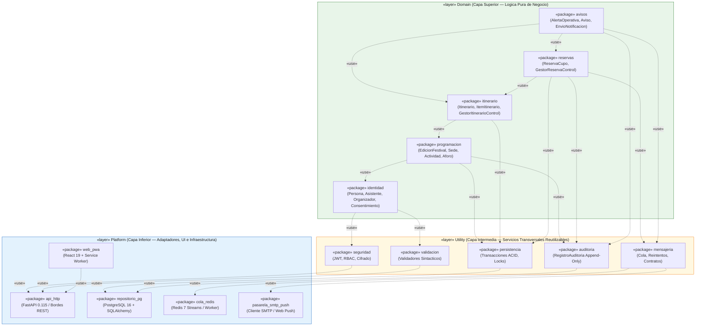
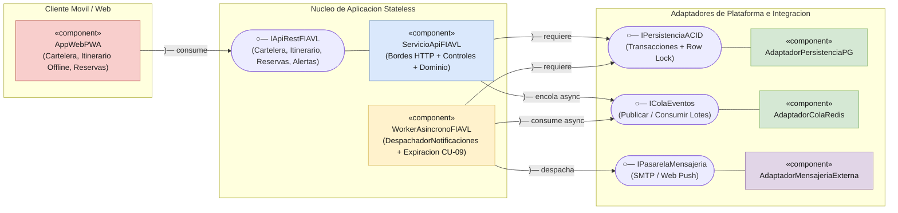

# Vista de Desarrollo: Paquetes en 3 Capas, Componentes UML 2.5.1 y ADRs — FIAVL

- **Sección del DAS:** Sección 6 — Vista de Desarrollo del Modelo 4+1 de Kruchten
- **Sistema de Interés:** Gestor de Programación e Itinerarios Urbanos del Festival Internacional de Artes Vivas de Loja (FIAVL)
- **Entradas SDD trazadas:**
  - [`specs/000-tdr/tdr-y-requisitos.md`](../../specs/000-tdr/tdr-y-requisitos.md) (`RU-01`..`RU-09`, `RF-01`..`RF-18`, `SUP-01`..`SUP-08`)
  - [`docs/architecture/00-overview-42010.md`](./00-overview-42010.md) (`INT-01`..`INT-05`, `RNF-01`..`RNF-05`, `RSK-01`..`RSK-06`)
  - [`docs/architecture/01-scenarios-view.md`](./01-scenarios-view.md) (`CU-01`..`CU-11`)
  - [`docs/architecture/02-logical-view.md`](./02-logical-view.md) (15 clases `«entity»`, 6 paquetes lógicos)
  - [`docs/architecture/03-process-view.md`](./03-process-view.md) (Patrón ECB, `«boundary»`, `«control»`, `«entity»`)
- **Marco normativo:** `AGENTS.md` (R2 tres capas descendentes acíclicas y 1:1, R6 Mermaid / DeepWiki), `docs/architecture/GUIA_METODOLOGICA_DAS.md` §6 y §7, OMG UML 2.5.1, ISO/IEC/IEEE 42010 e ISO/IEC 25010:2023.

---

## 1. Propósito de la Vista de Desarrollo y Principio Gravitacional (R2)

La **Vista de Desarrollo** traduce el modelo conceptual (`02-logical-view.md`) y los flujos dinámicos ECB (`03-process-view.md`) a la organización estática del código fuente y sus unidades modulares reemplazables (**Paquetes** y **Componentes**).

En cumplimiento estricto de la regla **R2** de `AGENTS.md` y las tres leyes de Kruchten (**Partición**, **Agrupamiento** y **Visibilidad**):
1. Todo el código se organiza en **exactamente tres capas descendentes acíclicas (DAG)**: `«Domain» → «Utility» → «Platform»`.
2. **Prohibición de saltos y ciclos:** ningún paquete de `«Domain»` puede importar directa ni transitivamente `«Platform»`; prohibido todo ciclo entre capas o entre paquetes de una misma capa.
3. **Cero carpetas cajón de sastre:** quedan prohibidos nombres genéricos como `Common`, `Común`, `General`, `Shared`, `Utils`, `Helpers` o `Misc`.
4. **Correspondencia 1:1:** cada paquete del Diagrama de Paquetes corresponde exactamente a un directorio físico en `src/`.

---

## 2. Derivación de Paquetes `«Domain»` (4 Pasos)

A partir de las 15 entidades de [`02-logical-view.md`](./02-logical-view.md) y los controladores ECB de [`03-process-view.md`](./03-process-view.md), los 5 paquetes de dominio se derivan agrupando entidades fuertemente cohesionadas, sus casos de uso y los `«control»` que los orquestan:

| Paquete `«Domain»` | Directorio `src/` | Entidades (`02-logical-view.md`) | Controladores ECB (`03-process-view.md`) | Casos de Uso | Depende en `«Domain»` de |
| :--- | :--- | :--- | :--- | :--- | :--- |
| **`identidad`** | `src/domain/identidad/` | `Persona`, `Asistente`, `Organizador`, `Consentimiento` | `AutenticacionControl`, `GestorConsentimientoControl` | `CU-05`, `CU-11` | *(ninguno — raíz del DAG)* |
| **`programacion`** | `src/domain/programacion/` | `EdicionFestival`, `Sede`, `Actividad`, `Aforo` | `GestorProgramacionControl`, `ControlOcupacionControl` | `CU-01`, `CU-06`, `CU-08` | `identidad` |
| **`itinerario`** | `src/domain/itinerario/` | `Itinerario`, `ItemItinerario` | `GestorItinerarioControl` | `CU-02` | `identidad`, `programacion` |
| **`reservas`** | `src/domain/reservas/` | `ReservaCupo` | `GestorReservaControl`, `LiberadorReservasControl` | `CU-03`, `CU-04`, `CU-09` | `identidad`, `programacion`, `itinerario` |
| **`avisos`** | `src/domain/avisos/` | `AlertaOperativa`, `Aviso`, `EnvioNotificacion` | `GestorAlertaControl`, `DespachadorNotificacionesControl` | `CU-07`, `CU-10` | `identidad`, `programacion`, `itinerario`, `reservas` |

> **Verificación DAG (0 ciclos):** El orden topológico estricto es `avisos → reservas → itinerario → programacion → identidad`. Ningún paquete inferior conoce a uno superior. (`RegistroAuditoria` pasa la Prueba del Ácido y se eleva a servicio transversal en `«Utility» / auditoria`.)

---

## 3. Prueba del Ácido de las 3 Preguntas para `«Utility»`

Todo candidato a la capa intermedia `«Utility»` debe responder **SÍ rotundo** a las tres preguntas normativas (`GUIA_METODOLOGICA_DAS.md` §6):

| Candidato | P1: ¿Usado por ≥ 2 dominios? | P2: ¿Copiable íntegro a otra industria? | P3: ¿Sin reglas de negocio FIAVL? | Veredicto | Paquete Destino |
| :--- | :---: | :---: | :---: | :---: | :--- |
| **Autenticación JWT / Hashing / RBAC técnico** | Sí (5 dominios) | Sí | Sí | **APROBADO** | `src/utility/seguridad/` |
| **Bitácora de auditoría inmutable (*append-only*)** | Sí (`programacion`, `reservas`, `avisos`, `identidad`) | Sí | Sí | **APROBADO** | `src/utility/auditoria/` |
| **Despacho técnico de cola / reintentos exponenciales** | Sí (`reservas`, `avisos`) | Sí | Sí | **APROBADO** | `src/utility/mensajeria/` |
| **Gestión de transacciones ACID y locks de fila** | Sí (5 dominios) | Sí | Sí | **APROBADO** | `src/utility/persistencia/` |
| **Validación sintáctica de fechas, textos y códigos** | Sí (5 dominios) | Sí | Sí | **APROBADO** | `src/utility/validacion/` |
| **Cálculo de solapamientos y traslado entre sedes FIAVL** | No (`itinerario`) | No | No (`RN-13`, `SUP-04`) | **RECHAZADO** | Permanece en `src/domain/itinerario/` |
| **Regla de tope de 2 cupos y ventana de 30 min** | No (`reservas`) | No | No (`RN-09`, `RN-11`) | **RECHAZADO** | Permanece en `src/domain/reservas/` |

---

## 4. Diagrama de Paquetes UML 2.5.1 — Tres Capas Acíclicas (Mermaid / DeepWiki)



> **Regla de Aislamiento verificada:** `«Domain»` nunca importa `«Platform»`. Toda lectura/escritura SQL, envío SMTP/Push o serialización HTTP está aislada detrás de `«Utility»` y sus adaptadores en `«Platform»` (**Mantenibilidad** y **Flexibilidad**, ISO/IEC 25010:2023).

---

## 5. Diagrama de Componentes UML 2.5.1 (Ley de Ensamblaje *Ball-and-Socket*)

A diferencia de los **Paquetes** (agrupaciones estáticas en código), los **Componentes (`«component»`)** son unidades modulares reemplazables en tiempo de ejecución que se ensamblan únicamente mediante **Interfaces Proporcionadas (`○—`)** e **Interfaces Requeridas (`)—`)**:



### Contratos de Interfaz entre Componentes

| Interfaz | Tipo | Proveedor | Consumidores | Propósito y RNF Protegido |
| :--- | :---: | :--- | :--- | :--- |
| **`IApiRestFIAVL`** | Proporcionada | `ServicioApiFIAVL` | `AppWebPWA` | Expone operaciones REST/JSON sobre HTTPS para `CU-01`..`CU-08` y `CU-11` (`RNF-01`, `RNF-03`, `RNF-04`). |
| **`IPersistenciaACID`** | Proporcionada | `AdaptadorPersistenciaPG` | `ServicioApiFIAVL`, `WorkerAsincronoFIAVL` | Garantiza transacciones ACID y bloqueo de fila para `Aforo.descontar` con **0 sobreventas** (`RNF-02`, `RSK-01`). |
| **`IColaEventos`** | Proporcionada | `AdaptadorColaRedis` | `ServicioApiFIAVL` (productor), `WorkerAsincronoFIAVL` (consumidor) | Desacopla el envío de correos/push del hilo HTTP principal (`RNF-01`, `RNF-02`, `RSK-03`). |
| **`IPasarelaMensajeria`** | Proporcionada | `AdaptadorMensajeriaExterna` | `WorkerAsincronoFIAVL` | Aísla el protocolo SMTP/Web Push con *timeouts* de 5 s y reintentos sin afectar el núcleo (`RNF-02`, `RNF-05`). |

---

## 6. Clasificación de Plataforma en 6 Niveles Tecnológicos

Toda tecnología adoptada en `«Platform»` se documenta con versión exacta, licencia y justificación trazada a ISO/IEC 25010:2023:

| Nivel | Categoría | Tecnología y Versión Exacta | Licencia | Justificación Arquitectónica (FIAVL) |
| :---: | :--- | :--- | :--- | :--- |
| **1** | Servicios Externos | **SMTP / Web Push (VAPID RFC 8292)** vía proveedor externo | Estándar abierto / SaaS | Entrega notificaciones sin operar servidores de correo propios (`SUP-05`, `RNF-02`). |
| **2** | Software de Infraestructura | **PostgreSQL 16.4**, **Redis 7.4**, **Nginx 1.27** | PostgreSQL / BSD / BSD | ACID estricto con `SELECT FOR UPDATE` (0 sobreventas), cola duradera y proxy inverso TLS 1.3 (`RNF-02`, `RNF-03`). |
| **3** | Frameworks y Bibliotecas | **FastAPI 0.115**, **SQLAlchemy 2.0**, **React 19.0**, **Workbox 7.3** | MIT / MIT / MIT / MIT | Validación estricta de bordes, ORM desacoplado en `Platform` y caché PWA *offline-first* en calle (`RNF-01`, `RNF-04`). |
| **4** | Lenguaje y Runtime | **Python 3.12** (backend/worker) y **Node.js 22 LTS / TypeScript 5.6** (build PWA) | PSF / MIT / Apache 2.0 | Ecosistema productivo para equipo de 3 integrantes, tipado fuerte y fácil mantenimiento (`RNF-05`). |
| **5** | Sistema Operativo | **Linux Debian 12 (Bookworm) / Alpine 3.20** en contenedores OCI | GPL / MIT | Imágenes ligeras, seguras y reproducibles para réplicas *stateless* en ≤ 2 min (`RNF-05`). |
| **6** | Hardware / Nube IaaS | **Contenedores Docker 27 / Cloud VPS o Kubernetes gestionado** | Apache 2.0 / Comercial | Aislamiento de red privada, escalado horizontal elástico y respaldos automatizados PITR (`RNF-02`, `RNF-05`). |

---

## 7. Correspondencia 1:1 con la Estructura de Directorios (`src/`)

En cumplimiento de **R2**, la estructura física de `src/` refleja exactamente los paquetes del Diagrama de Paquetes (se poblará únicamente tras pasar la compuerta SDD **R1**):

```text
src/
├── domain/
│   ├── identidad/        # Persona, Asistente, Organizador, Consentimiento
│   ├── programacion/     # EdicionFestival, Sede, Actividad, Aforo
│   ├── itinerario/       # Itinerario, ItemItinerario, GestorItinerarioControl
│   ├── reservas/         # ReservaCupo, GestorReservaControl, LiberadorReservasControl
│   └── avisos/           # AlertaOperativa, Aviso, EnvioNotificacion, DespachadorNotificacionesControl
├── utility/
│   ├── seguridad/        # Tokens JWT, RBAC, hashing de credenciales
│   ├── auditoria/        # RegistroAuditoria inmutable append-only
│   ├── mensajeria/       # Contratos de encolamiento y politica de reintentos
│   ├── persistencia/     # Unidad de trabajo ACID y abstraccion de bloqueo
│   └── validacion/       # Validadores sintacticos reutilizables
└── platform/
    ├── web_pwa/          # Interfaz React + Service Worker offline-first
    ├── api_http/         # Bordes FastAPI (InterfazItinerarioUI, InterfazReservaUI, InterfazGestionAlertaUI)
    ├── repositorio_pg/   # Adaptador PostgreSQL 16 (migraciones, modelos fisicos)
    ├── cola_redis/       # Adaptador Redis Streams y worker de consumo
    └── pasarela_smtp_push/ # Adaptador PasarelaMensajeria (SMTP / Web Push)
```

---

## 8. Registro de Decisiones Arquitectónicas (ADRs — 4 Partes)

### ADR-001: Monolito Modular en 3 Capas Acíclicas + Worker Asíncrono
- **Contexto:** Equipo universitario de 3 integrantes construyendo un sistema de alta concurrencia puntual (10 días de festival, 300 usuarios concurrentes) con requisito de mantenibilidad (`RNF-05`) y tolerancia a fallos externos (`RNF-02`).
- **Alternativas evaluadas:** (a) Microservicios distribuidos por cada dominio (6 servicios + API Gateway + Saga distribuida); (b) Monolito en capas sin separación `Utility`/`Platform`; (c) Monolito modular estricto en 3 capas (`Domain → Utility → Platform`) + proceso `Worker` desacoplado.
- **Decisión tomada:** Adoptar **(c) Monolito Modular en 3 Capas + Worker Asíncrono**.
- **Consecuencias:** Reduce drásticamente la complejidad operativa para 3 personas, garantiza transacciones ACID simples sobre `Aforo` sin Sagas distribuidas, y mantiene fronteras limpias que permiten extraer `avisos` o `reservas` en el futuro sin reescribir el dominio.

### ADR-002: Exclusión Mutua Pesimista en PostgreSQL para Cero Sobreventas
- **Contexto:** `CU-03` exige **0 sobreventas** ante 50 peticiones simultáneas sobre el último cupo de un teatro (`RNF-02`, `RSK-01`, seguridad física de recintos).
- **Alternativas evaluadas:** (a) Validación optimista en memoria RAM de la API; (b) Bloqueo distribuido exclusivo en Redis; (c) Transacción ACID en PostgreSQL 16 con bloqueo de fila (`SELECT ... FOR UPDATE`) sobre el registro de aforo.
- **Decisión tomada:** Adoptar **(c) Transacción ACID + bloqueo pesimista de fila en PostgreSQL 16** encapsulado tras `utility/persistencia`.
- **Consecuencias:** Permite que `ServicioApiFIAVL` sea **100 % *stateless*** (replicable horizontalmente en ≤ 2 min), elimina condiciones de carrera entre réplicas y mantiene la latencia de reserva muy por debajo del umbral de 2 s (`RNF-01`).

### ADR-003: Cliente Web Responsivo PWA (*Offline-First*) para Uso en Calle
- **Contexto:** Los asistentes consultan su itinerario caminando por las calles y plazas de Loja con señal móvil intermitente (`RNF-01`, `RSK-02`, `SUP-02`).
- **Alternativas evaluadas:** (a) Apps nativas iOS/Android separadas; (b) Web tradicional dependiente 100 % de conexión; (c) Progressive Web App (PWA) con Service Worker y caché local sincronizada.
- **Decisión tomada:** Adoptar **(c) PWA *Offline-First*** (`platform/web_pwa`).
- **Consecuencias:** Cero fricción de instalación en tiendas, lectura del itinerario en calle en `< 1.0 s` sin señal (`RNF-01`), y un único código base frontend para móvil y escritorio.

---

## 9. Lista de Verificación de la Vista de Desarrollo

- [x] **R2 (3 capas acíclicas):** `Domain → Utility → Platform` sin saltos `Domain → Platform` ni ciclos.
- [x] **R2 (Sin cajones de sastre):** 0 paquetes llamados `Common`, `Shared`, `Utils`, `Helpers` o `General`.
- [x] **R2 (Correspondencia 1:1):** Mapa exacto entre paquetes del diagrama y `src/{domain,utility,platform}/`.
- [x] **Prueba del Ácido:** Aplicada y documentada con casos aprobados y rechazados.
- [x] **Componentes UML 2.5.1:** Interfaces proporcionadas (`○—`) y requeridas (`)—`) explícitas.
- [x] **R6 (Mermaid / DeepWiki):** 2 diagramas estándar (`flowchart` ×2) validados con `mmdc` sin errores.
