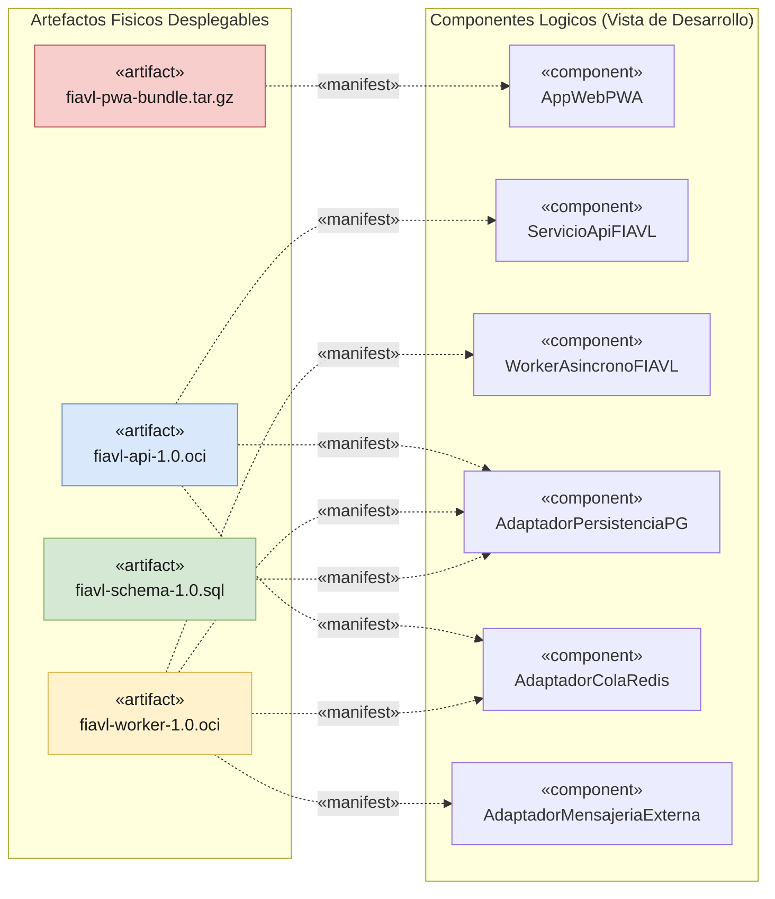
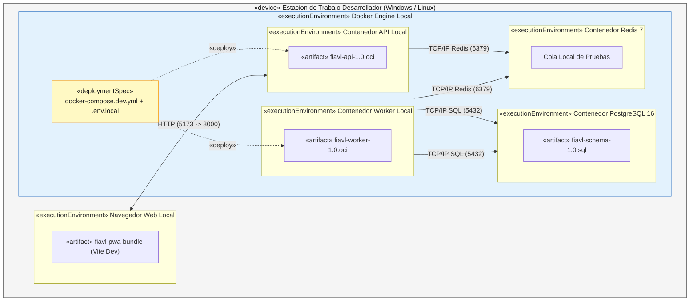
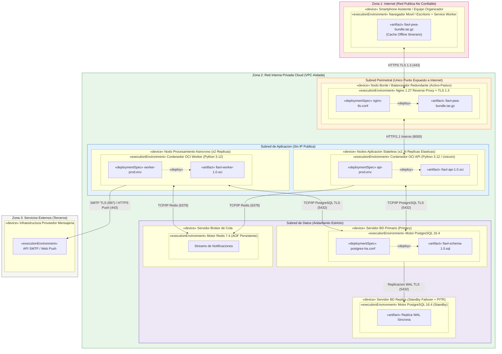

# Vista de Despliegue: Topología Física UML 2.5.1, Multi-Entorno y Auditoría SPOF — FIAVL

- **Sección del DAS:** Sección 7 — Vista de Despliegue del Modelo 4+1 de Kruchten
- **Sistema de Interés:** Gestor de Programación e Itinerarios Urbanos del Festival Internacional de Artes Vivas de Loja (FIAVL)
- **Entradas SDD trazadas:**
  - [`docs/architecture/00-overview-42010.md`](./00-overview-42010.md) (`RNF-01`..`RNF-05`, `RSK-01`..`RSK-06`)
  - [`docs/architecture/03-process-view.md`](./03-process-view.md) (Topología de procesos *stateless*, worker asíncrono, lock de fila)
  - [`docs/architecture/04-development-view.md`](./04-development-view.md) (Paquetes en 3 capas y Componentes `«component»` con interfaces)
- **Marco normativo:** `AGENTS.md` (R5 rigor UML 2.5.1, R6 Mermaid / DeepWiki), `docs/architecture/GUIA_METODOLOGICA_DAS.md` §7 y §8, OMG UML 2.5.1, ISO/IEC/IEEE 42010 e ISO/IEC 25010:2023.

---

## 1. Cadena de Trazabilidad de 5 Eslabones (UML 2.5.1 — R5)

En estricto cumplimiento de **UML 2.5.1** y la regla **R5** de `AGENTS.md`, **no se dibujan componentes directamente dentro de nodos**. Todo elemento físico respeta la cadena de 5 eslabones:

`1. Clase (Vista Lógica) → 2. Paquete (Vista de Desarrollo) → 3. Componente («component») → 4. Artefacto («artifact», relación «manifest») → 5. Entorno/Dispositivo («executionEnvironment» anidado en «device», relación «deploy»)`

### 1.1 Inventario de Artefactos, Especificaciones y Matriz `«manifest»` (Paso 1)

| Artefacto (`«artifact»`) | Especificación (`«deploymentSpec»`) | Componentes Manifestados (`«manifest»`) | Paquetes de `src/` Materializados | Entorno Destino (`«executionEnvironment»`) |
| :--- | :--- | :--- | :--- | :--- |
| **`fiavl-pwa-bundle.tar.gz`** | `nginx-tls.conf` (cabeceras CSP, caché PWA, TLS 1.3) | `AppWebPWA` | `platform/web_pwa` | `Nginx 1.27` (servido al `Navegador Móvil PWA`) |
| **`fiavl-api-1.0.oci`** | `api-prod.env` (puertos, JWT, pool BD, límites) | `ServicioApiFIAVL`, `AdaptadorPersistenciaPG`, `AdaptadorColaRedis` | `domain/*`, `utility/*`, `platform/api_http`, `platform/repositorio_pg`, `platform/cola_redis` | `Contenedor OCI API (Python 3.12 / Uvicorn)` |
| **`fiavl-worker-1.0.oci`** | `worker-prod.env` (reintentos, timeout 5 s, SMTP/VAPID) | `WorkerAsincronoFIAVL`, `AdaptadorPersistenciaPG`, `AdaptadorColaRedis`, `AdaptadorMensajeriaExterna` | `domain/reservas`, `domain/avisos`, `utility/*`, `platform/repositorio_pg`, `platform/cola_redis`, `platform/pasarela_smtp_push` | `Contenedor OCI Worker (Python 3.12)` |
| **`fiavl-schema-1.0.sql`** | `postgres-ha.conf` (aislamiento ACID, WAL, PITR) | Esquema relacional de `AdaptadorPersistenciaPG` | Migraciones en `platform/repositorio_pg` | `Motor PostgreSQL 16.4` |

> **Verificación de completitud:** Los **6 componentes** de [`04-development-view.md`](./04-development-view.md) quedan manifestados al 100 % en artefactos físicos desplegables (0 componentes huérfanos).

### 1.2 Diagrama de Manifestación (`«artifact» -.«manifest».-> «component»`)

---

## 2. Diagrama de Despliegue — Entorno de Desarrollo Local (Regla Multi-Entorno)

Demuestra que los **mismos artefactos** se despliegan en una estación local mediante `docker-compose.dev.yml` sin modificar una sola línea de código de dominio:

---

## 3. Diagrama de Despliegue — Entorno de Producción FIAVL (UML 2.5.1, Zonas de Red y Alta Disponibilidad)

Aplica los Pasos 2 al 7 del Algoritmo de 9 Pasos: separación estricta en **3 zonas de confianza** (Internet Pública, Red Interna Privada y Externo), nodos con multiplicidad explícita (`×2..N` réplicas *stateless*, `Primary + Standby`), entornos de ejecución anidados, especificaciones de despliegue y protocolos explícitos en cada enlace:

---

## 4. Las 4 Pruebas de Estrés Arquitectónicas y Plan de Contingencia SPOF (Paso 8)

La topología de producción supera las cuatro auditorías obligatorias de `GUIA_METODOLOGICA_DAS.md` §7:

| # | Prueba de Estrés | Escenario Simulado | Comportamiento de la Topología FIAVL | Estado |
| :-: | :--- | :--- | :--- | :---: |
| **1** | **Caída de instancia de aplicación** | Falla súbitamente 1 de las 2 réplicas de `fiavl-api-1.0.oci` en plena inauguración (300 concurrentes). | El balanceador Nginx detecta el *health-check* fallido en `< 5 s` y redirige el 100 % del tráfico a la réplica sana. Como la API es **100 % *stateless*** (tokens JWT + locks en PostgreSQL), no se pierde ninguna sesión ni se corrompe ningún aforo (`RNF-01`, `RNF-05`). Nueva réplica levanta en `≤ 2 min`. | **SUPERADA** |
| **2** | **Caída o latencia extrema de servicio externo** | El proveedor externo SMTP / Web Push cae o tarda 30 s en responder durante `CU-03` o `CU-07`. | La API solo encola el evento en Redis (`< 5 ms`) y responde al Asistente/Organizador. El `Worker` aplica *timeout* de 5 s, marca `EnvioNotificacion.estado = Fallido` y ejecuta reintentos exponenciales en segundo plano. **100 % de reservas y alertas siguen operando** (`RNF-02`, `RSK-03`). | **SUPERADA** |
| **3** | **Escáner de red malicioso desde Internet** | Un atacante escanea puertos desde Internet buscando PostgreSQL (`5432`), Redis (`6379`) o API (`8000`). | Solo el puerto `443 (HTTPS TLS 1.3)` del nodo perimetral Nginx es alcanzable desde Internet. Las subredes de Aplicación y Datos carecen de IP pública y están protegidas por reglas de firewall de VPC (`RNF-03`, `RSK-05`). | **SUPERADA** |
| **4** | **Detección de SPOFs visibles y ocultos** | Auditoría de posibles Puntos Únicos de Falla en BD, borde, cola y proveedor externo. | Se identifican y mitigan mediante el **Plan de Contingencia SPOF** documentado a continuación. | **MITIGADOS** |

### Plan de Contingencia Obligatorio contra SPOFs

| SPOF Potencial | Riesgo si no se mitiga | Mitigación Implementada en Producción |
| :--- | :--- | :--- |
| **Base de Datos PostgreSQL única** | Caída total de cartelera, itinerarios y reservas durante el festival. | Topología **Primary–Standby** con replicación WAL continua, *failover* automático (`RTO < 2 min`) y respaldos automatizados diarios + **PITR** (*Point-in-Time Recovery*) cada 5 min. |
| **Balanceador / Proxy inverso único** | Pérdida de acceso externo aun con nodos de aplicación sanos. | Configuración **Activo–Pasivo** con IP flotante administrada por el proveedor cloud (`RNF-02`). |
| **Broker Redis único** | Pérdida temporal de cola de notificaciones en vuelo. | Persistencia **AOF (*Append-Only File*)** habilitada + respaldo de estado en la entidad `EnvioNotificacion` en PostgreSQL: el *worker* puede reconstruir envíos `Pendiente` si Redis se reinicia. |
| **Proveedor externo único de mensajería** | Interrupción de correos/push en alertas urgentes (`CU-07`). | Bandeja interna `Aviso` en la PWA siempre disponible en plataforma (degradación elegante) + adaptador `platform/pasarela_smtp_push` intercambiable por configuración sin tocar `Domain`. |

---

## 5. Tabla de Nodos y Hardware Base — Entorno de Producción (Paso 9)

| Nodo (`«device»`) | Tipo | Entorno Anidado (`«executionEnvironment»`) | Artefactos Desplegados | Réplicas | Protocolos Entrada / Salida | Dimensionamiento Base (CPU / RAM / Disco / SO) |
| :--- | :--- | :--- | :--- | :---: | :--- | :--- |
| **`Smartphone / Equipo Cliente`** | Dispositivo usuario | Navegador Web + Service Worker PWA | `fiavl-pwa-bundle.tar.gz` | N (público) | Salida: `HTTPS (443)` | Móvil gama media / Escritorio moderno (iOS/Android/Windows/Linux) |
| **`Nodo Borde / Balanceador`** | VM / Servicio Cloud | `Nginx 1.27` (Reverse Proxy + TLS 1.3) | `fiavl-pwa-bundle.tar.gz`, `nginx-tls.conf` | 2 (Activo-Pasivo) | Entrada: `HTTPS (443)` / Salida: `HTTP (8000)` | 2 vCPU, 2 GB RAM, 20 GB SSD, Linux Alpine 3.20 |
| **`Nodos Aplicación Stateless`** | VM / Contenedor Cloud | `Contenedor OCI API` (Python 3.12 + Uvicorn) | `fiavl-api-1.0.oci`, `api-prod.env` | 2..N (elástico) | Entrada: `HTTP (8000)` / Salida: `PG (5432)`, `Redis (6379)` | 2 vCPU, 4 GB RAM c/u, 20 GB SSD, Debian 12 Slim |
| **`Nodo Procesamiento Asíncrono`** | VM / Contenedor Cloud | `Contenedor OCI Worker` (Python 3.12) | `fiavl-worker-1.0.oci`, `worker-prod.env` | 2 | Entrada/Salida: `Redis (6379)`, `PG (5432)` / Salida: `SMTP (587)`, `HTTPS (443)` | 2 vCPU, 2 GB RAM c/u, 20 GB SSD, Debian 12 Slim |
| **`Servidor BD Primario + Standby`** | VM / Managed DB | `PostgreSQL 16.4` | `fiavl-schema-1.0.sql`, `postgres-ha.conf` | 1 Primary + 1 Standby | Entrada: `PG TLS (5432)` / Salida: `WAL TLS (5432)` | 4 vCPU, 8 GB RAM, 100 GB NVMe + PITR, Debian 12 |
| **`Servidor Broker de Cola`** | VM / Managed Cache | `Redis 7.4` (AOF persistente) | Streams de despacho | 1 (con persistencia AOF + fallback BD) | Entrada: `Redis (6379)` | 2 vCPU, 2 GB RAM, 20 GB SSD, Linux Alpine 3.20 |

---

## 6. Cierre de Trazabilidad Completa del Modelo 4+1 (ISO/IEC/IEEE 42010)

| Vista 4+1 | Documento Versionado | Rol en la Defensa Arquitectónica FIAVL | Estado |
| :--- | :--- | :--- | :---: |
| **Overview 42010 / 25010** | [`00-overview-42010.md`](./00-overview-42010.md) | Stakeholders (`INT-01`..`INT-05`), RNFs medibles (`RNF-01`..`RNF-05`) y Riesgos (`RSK-01`..`RSK-06`). | Completo |
| **+1 Escenarios** | [`01-scenarios-view.md`](./01-scenarios-view.md) | Diagrama único UML 2.5.1 limpio sin cruces (`CU-01`..`CU-11`) + 3 especificaciones Cockburn (`CU-02`, `CU-03`, `CU-07`). | Completo |
| **Vista Lógica** | [`02-logical-view.md`](./02-logical-view.md) | 15 clases puras de dominio (R4), 2 máquinas de estado, CRC y diccionario (`RN-01`..`RN-17`). | Completo |
| **Vista de Procesos** | [`03-process-view.md`](./03-process-view.md) | Secuencias ECB estrictas (R3, 0 `Boundary ↔ Entity`), `[critical]` atómico, despacho `-)` asíncrono y trazabilidad 1:1. | Completo |
| **Vista de Desarrollo** | [`04-development-view.md`](./04-development-view.md) | 3 capas acíclicas `Domain → Utility → Platform` (R2), Prueba del Ácido, Componentes UML 2.5.1 y 3 ADRs. | Completo |
| **Vista de Despliegue** | [`05-deployment-view.md`](./05-deployment-view.md) | Cadena de 5 eslabones UML 2.5.1 (R5), multi-entorno Dev/Prod, 3 zonas de red, 4 pruebas de estrés y plan SPOF. | Completo |

---

## 7. Lista de Verificación de la Vista de Despliegue

- [x] **R5 (Rigor UML 2.5.1):** Distingue explícitamente `«device»`, `«executionEnvironment»`, `«artifact»`, `«deploymentSpec»`, `«manifest»` y `«deploy»`.
- [x] **Regla multi-entorno:** Diagramas separados para **Desarrollo Local** y **Producción** con los mismos artefactos.
- [x] **Protocolos explícitos:** 100 % de enlaces etiquetados con protocolo y puerto (0 líneas mudas).
- [x] **4 Pruebas de Estrés + Plan SPOF:** Documentadas y mitigadas con Primary–Standby, PITR y diseño *stateless*.
- [x] **R6 (Mermaid / DeepWiki):** 3 diagramas estándar (`flowchart` ×3) validados con `mmdc` sin errores.
